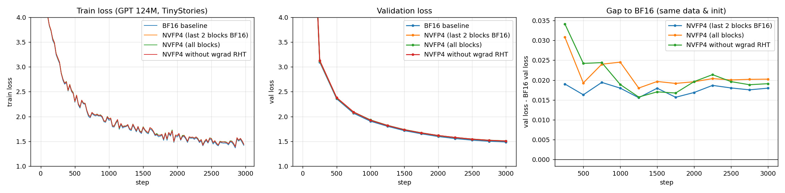

# nvfp4-train-sm120

**4-bit (NVFP4) training on consumer Blackwell GPUs (RTX 50-series, `sm_120`).**

The repository contains block-scaled FP4 tensor-core GEMMs, bit-exact fused quantizers (with
16-point random Hadamard transform and stochastic rounding), and a drop-in `NVFP4Linear` that runs
the forward, input-gradient and weight-gradient GEMMs in NVFP4.

Consumer Blackwell has hardware FP4 tensor cores, but its programming model differs from datacenter
Blackwell: warp-level `mma.sync` instead of `tcgen05`, no tensor memory, and about 99 KB of shared
memory. Mainstream training stacks don't yet use it for training. These kernels are written for
that model from the ground up (see [docs/DESIGN.md](docs/DESIGN.md)).

## Results on an RTX 5090 Laptop GPU

Full details and raw data are in [docs/RESULTS.md](docs/RESULTS.md).

| | |
|---|---|
| NVFP4 GEMM throughput | **261–356 TFLOPS**: **3.0–4.0× BF16 cuBLAS**. Faster than cuBLASLt NVFP4 on short-K shapes, about 86% of it on the longest K |
| Transformer block fwd+bwd | **1.29× (d=768) → 1.76× (d=2048) → 2.13× (d=4096)** vs BF16 |
| GPT-124M pretraining, 49M tokens | val loss **1.5064 vs 1.4884** BF16 (constant +0.018 gap, no divergence), **+10.7% tokens/s, −14.5% GPU energy** |
| Correctness | quantizer **bit-exact** vs the reference spec; GEMM = fp64 reference to ~1e-7; 64 tests |



## Quick start (WSL2 or Linux, RTX 50-series)

```bash
sudo tools/setup_wsl.sh            # CUDA 13.0 toolkit + venv with PyTorch 2.14 cu130 (~/nvfp4)
tools/check.sh                     # build the extension for sm_120a + run all tests
```

```python
import torch
from nvfp4.linear import NVFP4Linear, convert_linears

layer = NVFP4Linear(4096, 4096, bias=False).cuda()        # in/out features must be multiples of 128
y = layer(torch.randn(8192, 4096, device="cuda", dtype=torch.bfloat16))

# or convert an existing model's block linears, keeping the last blocks in BF16:
convert_linears(model.blocks, skip=("10.", "11."))

# low-level ops
from nvfp4 import quantize, gemm
qa = quantize(a)                                          # NVFP4Tensor(data, scales, gdec)
qb = quantize(b, block_2d=True)
d = gemm(qa, qb)                                          # D = A @ B^T on FP4 tensor cores
```

Requirements: an sm_120 GPU (RTX 5090/5080/5070/5060 or their laptop parts), CUDA ≥ 12.8 (tested
with 13.0), and a CUDA build of PyTorch (tested with 2.14.1+cu130, which needs C++20). Native Windows
builds haven't been tried. On a machine without such a GPU, `NVFP4Linear(..., backend="emulate")`
runs the same recipe through the pure-PyTorch reference.

## Layout

```
csrc/quantize.cu       BF16/FP32 -> NVFP4 (rowwise / transposed / 16x16 2D, RHT, stochastic rounding)
csrc/gemm.cu           mma.sync kind::mxf4nvf4 block-scaled TN GEMM, 4-stage cp.async pipeline
nvfp4/reference.py     executable spec of the format and recipe (pure PyTorch)
nvfp4/linear.py        NVFP4Linear autograd layer + convert_linears
tests/                 bit-exact / reference tests (GPU tests auto-skip without sm_120)
bench/                 GEMM, quantizer and transformer-block benchmarks (+ results/)
experiments/           TinyStories GPT pretraining: BF16 vs NVFP4 (+ results/)
tools/guard.py         runs jobs under GPU temperature / memory / host-RAM limits
docs/                  DESIGN.md, RESULTS.md, research/ (why this project exists)
```

## Status and limitations

This is a research-grade implementation, verified on one GPU. The known gaps are listed in
[docs/DESIGN.md §6](docs/DESIGN.md#6-known-limitations-and-next-steps):
- quantization isn't fused into producer ops;
- there's no split-K;
- backward re-quantizes saved BF16 activations;
- only Linux/WSL2 is supported.

## License

Apache-2.0
