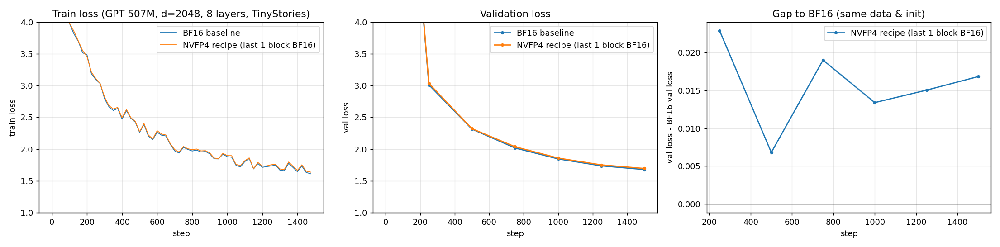

# nvfp4-train-sm120

**4-bit (NVFP4) training on consumer Blackwell GPUs (RTX 50-series, `sm_120`), with 8-bit attention.**

The repository contains block-scaled FP4 tensor-core GEMMs (a persistent TMA-fed main loop plus
split-K, with bias / residual adds in the epilogue), bit-exact fused quantizers that emit an operand
and its transpose in one pass (with 16-point random Hadamard transform and stochastic rounding, and
with LayerNorm / RMSNorm / GELU / SwiGLU computed inside the quantizer), and drop-in layers and
transformer sub-blocks that run the forward, input-gradient and weight-gradient GEMMs in NVFP4 and
save only 4-bit operands for backward. Attention runs on INT8 / MXFP8 tensor cores (forward and a
deterministic backward).

Consumer Blackwell has hardware FP4 tensor cores, but its programming model differs from datacenter
Blackwell: warp-level `mma.sync` instead of `tcgen05`, no tensor memory, and about 99 KB of shared
memory. Mainstream training stacks don't yet use it for training. These kernels are written for
that model from the ground up (see [docs/DESIGN.md](docs/DESIGN.md)).

## Results on an RTX 5090 Laptop GPU

Full details and raw data are in [docs/RESULTS.md](docs/RESULTS.md).

| | |
|---|---|
| NVFP4 GEMM throughput | **273–441 TFLOPS**: **3.1–5.0× BF16 cuBLAS**; 0.91–1.98× cuBLASLt NVFP4 (above it on 10 of 11 shapes, up to 2× on short K) |
| Fused dual quantizer | operand + transposed operand in one pass: **1.6–2.3×** faster than two separate quantizations |
| GPT block fwd+bwd (v0.8) | **1.82× (d=768) → 2.65× (d=2048) → 3.22× (d=4096)** vs BF16 (**3.50×** for micro-batches after the first, with the weight cache), 5–12% less memory |
| GPT-507M (d=2048) pretraining | val loss **1.6954 vs 1.6786** BF16 (+1.0%), **1.62× tokens/s, −39% GPU energy** |
| GPT-124M (d=768) pretraining, 49M tokens | val loss **1.5062 vs 1.4892** BF16 (constant ~0.017 gap, no divergence), **+27% tokens/s, −22% GPU energy** |
| Same, three seeds (v0.5) | gap **+0.019 ± 0.002** nats (+1.28%), constant over training for every seed; +27.7% tokens/s |
| Framework integration (v0.5) | `torch.compile(fullgraph=True)` without graph breaks (bit-identical to eager), CUDA-graph capture of whole training steps, no host syncs, DDP and FSDP2 bit-exact vs single process |
| Llama-style block (v0.7–v0.8) | RMSNorm, SwiGLU, residual adds and the q / k / v hand-off fused: **2.09× (d=1024) → 3.32× (d=4096)** vs BF16, 18–30% faster than unfused NVFP4; with the weight cache **up to 3.64×** |
| v0.8 | persistent TMA GEMM (8–17% fewer cycles at locked clocks, 8192³ above cuBLASLt at the power limit); residual adds, biases and q / k / v fused into GEMM epilogues and a deterministic norm-backward kernel; post-norm blocks; stochastic rounding at half the hashing cost |
| Desktop RTX 5090 ×2 (v0.8, rented) | GEMM **up to 1027 TFLOPS, 1.03–1.71× cuBLASLt** on every shape; GPT block 3.27× BF16 (3.46× cached), Llama 3.30× (3.49×); GPT-124M +32% tokens/s at the same loss; **NCCL across two GPUs** bit-exact (DDP, FSDP1, FSDP2); 625 tests + sanitizers clean on CUDA 12.8 / PyTorch 2.11 |
| 8-bit attention (v0.9) | INT8 scores + MXFP8 probabilities, BF16 dQ, deterministic backward: forward **1.6–2.2×** flash attention from 4k tokens, fwd+bwd 1.14–1.18×; quality: unchanged at 512 tokens, **+0.5% loss at 4096** (GPT-124M) |
| Platforms (v0.6) | Linux / WSL2 and **native Windows** (MSVC build, tests on the GPU, CI compile job); DDP, **FSDP1** and FSDP2 bit-exact; bitwise-reproducible training with PyTorch's flash attention in deterministic mode |
| Correctness | quantizers and every fused producer (LayerNorm, RMSNorm, GELU tanh / exact, SwiGLU, with biases) **bit-exact** vs the reference spec; fused blocks' outputs bit-identical to the unfused composition; GEMM = fp64 reference to ~1e-7; compute-sanitizer clean (memcheck, racecheck, synccheck, initcheck); soak runs with bit-exact replays; 682 tests |



## Quick start (RTX 50-series)

```bash
# WSL2 or Linux
sudo tools/setup_wsl.sh            # CUDA 13.0 toolkit + venv with PyTorch 2.14 cu130 (~/nvfp4)
pip install --no-build-isolation . # build the extension for sm_120a (or: pip wheel ... for a wheel)
tools/check.sh                     # run all tests; `tools/check.sh release` adds sanitizers + soak
```

```bat
:: native Windows (CUDA >= 12.8, Visual Studio 2022 C++, a CUDA build of PyTorch >= 2.7)
tools\build.cmd
tools\check.cmd
```

**Integrating into a training stack:** read [docs/USAGE.md](docs/USAGE.md) (requirements, options,
guarantees, production caveats, troubleshooting). Changes per version: [CHANGELOG.md](CHANGELOG.md).

```python
import torch
from nvfp4 import NVFP4Linear, convert_linears

layer = NVFP4Linear(4096, 4096, bias=False).cuda()        # in/out features must be multiples of 128
y = layer(torch.randn(8192, 4096, device="cuda", dtype=torch.bfloat16))

# or convert an existing model's block linears, keeping the last blocks in BF16:
convert_linears(model.blocks, skip=("10.", "11."))

# transformer blocks with norm, activation and residual adds fused (Llama style; GPT: layernorm_*)
from nvfp4 import rmsnorm_linear, rmsnorm_swiglu_mlp
q, k, v, res = rmsnorm_linear(x, blk.norm1, blk.qkv, chunks=3, return_residual=True)
x = blk.o_proj(attn(q, k, v), residual=res)               # x + o_proj(attn), add in the GEMM epilogue
x = rmsnorm_swiglu_mlp(x, blk.norm2, blk.gate, blk.up, blk.down, residual=True)  # x + down(silu(g) * u)

# 8-bit flash attention (q [B, H, N, D], k / v [B, Hkv, N, D]); a drop-in for causal / full SDPA
from nvfp4.attention import attention
o = attention(q, k, v, causal=True)

# reuse quantized weights across the micro-batches of an optimizer step
convert_linears(model.blocks, cache_weight_quantization=True)

# low-level ops
from nvfp4 import quantize, gemm
qa = quantize(a)                                          # NVFP4Tensor(data, scales, gdec)
qb = quantize(b, block_2d=True)
d = gemm(qa, qb)                                          # D = A @ B^T on FP4 tensor cores
```

Requirements: an sm_120 GPU (RTX 5090/5080/5070/5060 or their laptop parts), CUDA ≥ 12.8 (tested
with 13.0, and 12.9 on Windows), and a CUDA build of PyTorch (tested with 2.14.1+cu130 and, on
Windows, 2.7.1+cu128). On a machine without such a GPU, `NVFP4Linear(..., backend="emulate")`
runs the same recipe through the pure-PyTorch reference.

## Layout

```
csrc/quantize_dual.cu  fused BF16/FP32 -> NVFP4 rowwise + transposed (RHT, SR, 16x16 2D) in one pass,
                       optionally applying LayerNorm / RMSNorm / GELU / SwiGLU (and backwards) while loading
csrc/quantize.cu       single-output quantizer (rowwise / transposed / 16x16 2D, RHT, stochastic rounding)
csrc/gemm_tma.cu       mma.sync kind::mxf4nvf4 block-scaled TN GEMM, persistent TMA + mbarrier pipeline
csrc/gemm.cu           cp.async GEMM main loop (short K / fallback) and host dispatch
csrc/gemm_common.cuh   shared epilogue: deterministic split-K, fused fp32 accumulate, bias / residual add
csrc/norm.cu           LayerNorm / RMSNorm backward (+ residual gradient), deterministic
csrc/attention.cu      8-bit flash attention: operand quantizer, forward, deterministic dQ / dK-dV kernels
nvfp4/reference.py     executable spec of the format and recipe (pure PyTorch)
nvfp4/linear.py        NVFP4Linear autograd layer + convert_linears
nvfp4/attention.py     attention(q, k, v, causal=...) autograd function (SDPA fallback)
nvfp4/fused.py         layernorm_linear / layernorm_mlp / rmsnorm_linear / rmsnorm_swiglu_mlp / gelu_mlp /
                       swiglu_mlp: fused transformer sub-blocks
tests/                 bit-exact / reference tests (GPU tests auto-skip without sm_120)
bench/                 GEMM, quantizer and transformer-block benchmarks (+ results/)
experiments/           TinyStories GPT pretraining: BF16 vs NVFP4 (+ results/)
tools/guard.py         runs jobs under GPU temperature / memory / host-RAM limits, with cooldowns
tools/sanitize.sh      compute-sanitizer over every kernel variant; tools/soak.py: long-run soak test
docs/                  USAGE.md (integration guide), DESIGN.md, RESULTS.md, research/
```

## Status and limitations

Verified on the RTX 5090 Laptop and on two rented desktop RTX 5090s with the test, sanitizer and
soak suites above and end-to-end pretraining comparisons; validate the precision recipe on your own model before relying on
it. The known gaps are listed in
[docs/DESIGN.md §6](docs/DESIGN.md#6-known-limitations-and-next-steps):
- at equal clocks the GEMM keeps the tensor pipe 71% busy vs cuBLASLt's ~90%; at real clocks it is
  ahead of cuBLASLt on every shape (laptop and desktop RTX 5090), and the larger warp tile that would
  close it does not fit in 255 registers (v0.9 ablation);
- 8-bit attention speeds up the forward 1.6–2.2× but training only 1.14–1.18×, at +0.5% loss at 4096
  tokens; it covers causal / full masks, head dims 64 / 128 (other cases use SDPA);
- hardware stochastic rounding (`cvt.rs`) isn't available on sm_120a, so SR runs in software;
- tested on the RTX 5090 Laptop and the desktop RTX 5090 (also two of them over NCCL); not yet on
  the smaller RTX 50 parts.

## License

Apache-2.0
