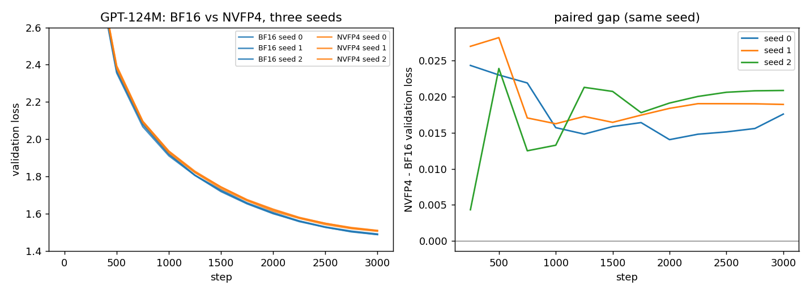

# Results

All results were measured on one machine on 2026-11-21/23:

- **GPU:** NVIDIA GeForce RTX 5090 **Laptop** GPU (GB203, 82 SMs, 24 GB, ~896 GB/s, 64 MB L2, ~175 W board power)
- **Driver:** 595.79 (Windows 11), running in WSL2 Ubuntu 22.04
- **Software:** CUDA 13.0, PyTorch 2.14.1+cu130

There are three versions of the stack ([DESIGN.md](DESIGN.md) has the details):

- **v0.1** quantized each operand with a separate kernel and saved BF16 activations for backward.
- **v0.2** added the fused dual quantizer (one read per operand), NVFP4-saved activations, the
  hardware E2M1 convert and optional fused wgrad accumulation.
- **v0.3** adds the TMA GEMM main loop, split-K for small output grids, and LayerNorm /
  GELU / GELU-backward fused into quantization.
- **v0.7** adds the weight-quantization cache and fused Llama-style blocks (§3.1–3.2).
- **v0.8** makes the TMA GEMM persistent (the pipeline carries across output tiles, refills
  start the moment a stage is free), fuses the residual adds, biases and the q/k/v hand-off (GEMM
  epilogue, in-place multi-part quantization, a LayerNorm / RMSNorm backward kernel that adds the
  residual gradient) and halves the stochastic-rounding hash work. §1 and §3 are v0.8 numbers.
- **v0.4 – v0.6** did not change the kernels' speed: v0.4 hardened them (NaN propagation,
  checks, sanitizers), v0.5 moved the rounding seeds to the GPU and integrated the layers with
  `torch.compile`, CUDA graphs, DDP and FSDP2. v0.5 adds a three-seed quality study (§4.1).
- **v0.9 – v0.11** add 8-bit attention (§7), the 2026 recipe options and a BF16-tail switch with a
  three-seed ablation (§2.4, §4.2), and mixture-of-experts layers (§8).

Raw data sits next to each table: `bench/results/*.json` and `experiments/results/**`.
Every benchmark checks correctness against the fp64 reference before timing. Timings are the
median of 7 trials, each a batch of back-to-back launches (see `bench/bench_gemm.py::timeit` for why
per-launch syncing is misleading on a laptop GPU). This is one laptop at its power limit; expect
about 5–10% run-to-run variation, more for cuBLASLt (the same shape measured 334–418 TFLOPS on
different runs).

## 1. GEMM throughput (TFLOPS, `bench/results/gemm.json`)

| M × N × K | BF16 cuBLAS | **NVFP4, this repo (v0.8)** | v0.7 | v0.2 main loop (cp.async) | incl. quantizing both operands | NVFP4 cuBLASLt (`torch._scaled_mm`) | ours / BF16 | ours / cuBLASLt |
|---|---|---|---|---|---|---|---|---|
| 2048³ | 86 | **293** | 289 | 258 | 189 | 237 | 3.42× | 1.24 |
| 4096³ | 93 | **406** | 385 | 336 | 282 | 338 | 4.38× | 1.20 |
| 8192³ | 89 | **441** | 410 | 375 | 310 | 427 | 4.97× | 1.03 |
| 8192×8192×2048 | 99 | **392** | 364 | 321 | 321 | 215 | 3.95× | 1.82 |
| 8192×2048×8192 | 93 | **425** | 401 | 347 | 239 | 341 | 4.59× | 1.25 |
| 2048×8192×8192 | 92 | **432** | 407 | 356 | 244 | 334 | 4.69× | 1.29 |
| 8192×3072×768 | 87 | **275** | 277 | 256 | 180 | 139 | 3.14× | 1.98 |
| 8192×768×3072 | 92 | **397** | 390 | 323 | 122 | 334 | 4.33× | 1.19 |
| 768×3072×8192 | 85 | **414** | 393 | 341 | 134 | 393 | 4.86× | 1.05 |
| 768×768×8192 (split-K) | 84 | **273** | 266 | 218 | 128 | 214 | 3.26× | 1.28 |
| 2304×768×8192 | 95 | **313** | 308 | 276 | 19\* | 344 | 3.31× | 0.91 |

\* An outlier (it was in v0.7's run too): quantizing the two operands takes ~37 + 21 µs on their own,
so this column should read about 190 TFLOPS.

- **v0.8's persistent main loop** is up to 8% faster than v0.7 at the power limit (8192³: 441 vs 410, now
  above cuBLASLt's 427) and spends 8–17% fewer cycles at locked clocks; the accumulating wgrad GEMM
  (not in this table: `D += A·B^T` into an fp32 gradient) is 3–28% faster
  ([DESIGN.md §4.2](DESIGN.md)).
- **v0.3 closed the long-K gap to cuBLASLt** (v0.2 reached about 86% of it). How:
  [DESIGN.md §4.1](DESIGN.md).
- **The TMA loop is 7–25% faster than the v0.2 loop** on every shape it handles (K ≥ 1024, and from
  K = 512 when there are at least 8 output tiles per SM).
- **Split-K** lifts the 36-tile 768×768×8192 wgrad from 218 to 273 TFLOPS (+25%).
- **Against BF16:** 3.1–5.0× BF16 cuBLAS; against cuBLASLt NVFP4: 0.91–1.98×, below it only on
  2304×768×8192.
- **Locked-clock caveat:** at equal (profiler-locked) clocks cuBLASLt's kernel still takes fewer cycles
  (8192³: 3.65M vs 4.64M, tensor pipe ~90% vs 71%; v0.7: 5.10M, 64%). At the power limit, where
  training runs, that does not show ([DESIGN.md §4.2](DESIGN.md)).
- **Output agreement:** cuBLASLt and our output agree within bf16 rounding (max |Δ| / max |D| ≈ 0.4–0.7%).
  Ours matches the fp64 reference to about 1e-7.
- **Hardware ceiling:** NVIDIA's dense FP4 peak for the *desktop* RTX 5090 is 1676 TFLOPS. The
  laptop part has fewer than half its SMs and a 175 W board limit.

## 2. Quantizer (`bench/results/quantize.json`)

### 2.1 Fused dual quantizer vs the separate calls it replaces

Each case produces exactly the operand pair NVFP4Linear needs, so the outputs are bit-identical
(`tests/test_quantize_dual_cuda.py`). "Separate" is two single-output calls plus the row padding.

| Role in NVFP4Linear | Tensor | separate | **fused** | speedup |
|---|---|---|---|---|
| activation: X (RNE) + Xᵀ (RHT, padded to 128) | 8192 × 768 bf16 | 70.1 µs | **36.0 µs** | **1.95×** |
| | 8192 × 3072 bf16 | 362.4 µs | **157.3 µs** | **2.30×** |
| gradient: dY (SR) + dYᵀ (RHT + SR, padded) | 8192 × 2304 bf16 | 311.2 µs | **166.4 µs** | **1.87×** |
| | 8192 × 8192 bf16 | 1155 µs | **609 µs** | **1.90×** |
| weight: W + Wᵀ (16×16 2D blocks) | 3072 × 768 fp32 | 57.5 µs | **25.8 µs** | **2.23×** |
| | 8192 × 2048 fp32 | 290.3 µs | **182.5 µs** | **1.59×** |

v0.8's paired stochastic-rounding hash ([DESIGN.md §3.2](DESIGN.md)) made the gradient case 5–6%
faster than v0.7 (173 → 166 µs, 648 → 609 µs); measured in isolation, SR now adds 34–43% to the dual
quantizer instead of 48–61%, and 5–6% to the fused SwiGLU-backward quantizer instead of 9–11%.

### 2.2 Single-output quantizer

Effective GB/s counts one input read plus the NVFP4 output. The input is read twice (amax, then
quantize). An 8192 × 2048 bf16 tensor (32 MB) fits in the 64 MB L2, so its first row exceeds DRAM
bandwidth; the 8192² row (128 MB) is the DRAM-bound case.

| Tensor | rowwise | rowwise, 16×16 2D | transposed | transposed + RHT + SR (wgrad) | rowwise + SR |
|---|---|---|---|---|---|
| 8192 × 2048 bf16 | **1305 GB/s (33 µs)** — v0.1: 725 | 549 (v0.1: 470) | 613 (v0.1: 503) | 485 (v0.1: 254) | 709 (v0.7: 622) |
| 8192 × 8192 bf16 | 476 GB/s (361 µs) — v0.1: 488 | 198 (v0.1: 191) | 421 (v0.1: 406) | 367 (v0.1: 225) | 453 (v0.7: 408) |
| 768 × 8192 bf16 | 678 GB/s (24 µs) | 362 | 475 | 404 | 528 (v0.7: 467) |

Most of the gain over v0.1 came from the hardware `cvt.rn.satfinite.e2m1x2` convert, a
division-free stochastic-rounding path and per-CTA amax reduction (DESIGN.md §3.2–3.3).

### 2.3 LayerNorm and GELU fused into quantization (v0.3)

Device time of one d=768 / d=2048 block step (8192 tokens, profiler), same NVFP4 GEMMs, with and
without the producer fusion of [DESIGN.md §3.4](DESIGN.md):

| d_model | unfused | **LayerNorm / GELU / GELU-backward fused** | peak memory |
|---|---|---|---|
| 768 | 3.13 ms | **3.00 ms (−4%)** | 357 → 363 MiB |
| 2048 | 14.52 ms | **13.40 ms (−8%)** | 1229 → 1219 MiB |

Gone from the step: the LayerNorm forward kernels, the GELU and GELU-backward kernels, the bf16 copy
of the LayerNorm output, and the separate amax pass over each of those outputs.

### 2.4 Recipe options (v0.11–v0.12, `bench/results/quantize_recipes.json`)

Dual quantizer (bf16 input, row + column outputs, column RHT, column padding 128; `bench/bench_sr_cost.py`),
µs, for the recipe switches of [DESIGN.md §2.1](DESIGN.md). Activations use round-to-nearest, gradients
stochastic rounding on both outputs:

| shape | activation (RTN) | + Four Over Six | + MS-EDEN (RHT64) | gradient (SR) | + MS-EDEN | + MS-EDEN on dgrad (v0.12) |
|---|---|---|---|---|---|---|
| 8192 × 2304 | 86 | 136 (+59%) | 154 (+79%) | 118 | 173 (+46%) | 251 (+113%) |
| 8192 × 8192 | 432 | 549 (+27%) | 640 (+48%) | 493 | 725 (+47%) | 966 (+96%) |
| 16384 × 3072 | 345 | 452 (+31%) | 479 (+39%) | 402 | 528 (+31%) | 734 (+83%) |

(Re-measured for v0.12: within 3% of the v0.11 numbers.) Four Over Six quantizes every block twice;
MS-EDEN's 64-point transform adds a shared-memory exchange per 64 rows, and the gradient operand an
extra error reduction per block. MS-EDEN on dgrad rotates the row output as well, so both outputs pay
the transform. In the GPT-124M step these cost 2% (Four Over Six), 3% (MS-EDEN) and 4% (both) of
tokens/s; MS-EDEN on dgrad 18%, most of it the per-backward re-quantization of every weight under the
new rotation (§4.2).

## 3. Transformer-block training step vs width (`bench/results/train_step.json`)

This measures one pre-LN GPT block (qkv, SDPA attention, out-proj and a 4× MLP), forward and
backward, on 8192 tokens with BF16 autocast. The four linears either run in NVFP4 or stay BF16;
attention is BF16 SDPA in both. "NVFP4" is NVFP4Linear; "fused" adds the LayerNorm / GELU fusion and
fused wgrad accumulation (the configuration of the v0.3 training runs); "fused + residual" (v0.8) also
hands q / k / v over without a concatenation and fuses both residual adds (`chunks=3`,
`return_residual`, `residual=True`; [DESIGN.md §3.6](DESIGN.md)). Every variant is timed in two passes
in opposite orders and the best is kept (the power-limited GPU slows as it heats up). Peak memory is
the extra CUDA memory allocated during the step.

| d_model | BF16 step | NVFP4 | fused | **fused + residual** | **speedup** (fused / NVFP4) | linear TFLOPS, BF16 → NVFP4 | peak MiB, BF16 → fused + residual |
|---|---|---|---|---|---|---|---|
| 768 | 6.24 ms | 3.74 ms | 3.50 ms | **3.43 ms** | **1.82×** (1.78× / 1.67×) | 56 → 93 | 461 → 438 |
| 1024 | 10.30 ms | 5.49 ms | 5.05 ms | **4.92 ms** | **2.09×** (2.04× / 1.87×) | 60 → 113 | 624 → 588 |
| 2048 | 34.67 ms | 15.58 ms | 13.69 ms | **13.07 ms** | **2.65×** (2.53× / 2.23×) | 71 → 159 | 1441 → 1315 |
| 3072 | 79.57 ms | 29.18 ms | 27.62 ms | **25.07 ms** | **3.17×** (2.88× / 2.73×) | 70 → 191 | 2513 → 2248 |
| 4096 | 135.57 ms | 46.11 ms | 42.89 ms | **42.14 ms** | **3.22×** (3.16× / 2.94×) | 73 → 215 | 3841 → 3387 |

v0.7 measured 1.80× / 1.96× / 2.40× / 2.97× / 2.88× for "fused" at the same widths (v0.3: up to
3.10× at d=4096 in a cooler session); the v0.8 GEMM and quantizer changes lift every NVFP4 column.
The residual fusion uses 1–3% more peak memory than "fused" (the fp32 residual-stream gradient is
held while the norm backward runs).

- **Split-K's share** at d=768 (where the 768×768 projection wgrad splits): 3.64 ms with
  `NVFP4_GEMM_SPLITS=1` vs 3.60 ms auto, about 1% of the step.
- **Why the benefit grows with width:** GEMM time grows as d², while the quantization passes and the
  BF16 parts (attention, norms) grow more slowly.

### 3.1 Weight-quantization cache (v0.7, `bench_train_step.py`, `nvfp4_fused_cached`)

With `cache_weight_quantization=True` the NVFP4 copies of a weight are reused until an optimizer
step (or any other change) touches it, so under gradient accumulation every micro-batch after the
first skips the weight quantizer. The table is the steady state of such a micro-batch (same session):

| d_model | fused + residual | + weight cache | saved | speedup vs BF16 | peak MiB |
|---|---|---|---|---|---|
| 768 | 3.43 ms | 3.33 ms | 2.8% | 1.82× → 1.87× | 438 → 444 |
| 1024 | 4.92 ms | 4.77 ms | 3.0% | 2.09× → 2.16× | 588 → 594 |
| 2048 | 13.07 ms | 12.96 ms | 0.8% | 2.65× → 2.67× | 1315 → 1342 |
| 3072 | 25.07 ms | 23.82 ms | 5.0% | 3.17× → 3.34× | 2248 → 2310 |
| 4096 | 42.14 ms | 38.78 ms | 8.0% | 3.22× → **3.50×** | 3387 → 3496 |

The cached copies cost ~1.1 bytes per weight element.

### 3.2 Llama-style block (v0.7–v0.8, `bench/results/llama_block.json`)

One Llama-style block: RMSNorm, qkv, causal SDPA, o_proj, RMSNorm and a SwiGLU MLP (hidden ≈ 8/3·d,
rounded to 256), forward and backward on 8192 tokens with BF16 autocast. "NVFP4" converts the five
linears; "fused" uses `rmsnorm_linear` / `rmsnorm_swiglu_mlp` (RMSNorm and SwiGLU and its backward
inside the quantizers, one quantization of the normalized input shared by gate and up, fused wgrad
accumulation; the v0.7 API); "fused + residual" adds the v0.8 fusions (q / k / v chunks, residual
handle into the o_proj epilogue, `residual=True` MLP); "+ cache" adds the weight cache (micro-batches
after the first). Two passes in opposite orders, best kept.

| d_model (hidden) | BF16 step | NVFP4 | fused | **fused + residual** | **+ cache** | peak MiB, BF16 → NVFP4 → fused → + residual |
|---|---|---|---|---|---|---|
| 1024 (2816) | 11.05 ms | 6.48 ms (1.70×) | 5.68 ms (1.95×) | **5.29 ms (2.09×)** | **5.14 ms (2.15×)** | 688 → 648 → 601 → 618 |
| 2048 (5632) | 39.28 ms | 17.82 ms (2.20×) | 14.85 ms (2.64×) | **13.71 ms (2.87×)** | **13.12 ms (2.99×)** | 1541 → 1426 → 1330 → 1361 |
| 3072 (8192) | 80.83 ms | 32.03 ms (2.52×) | 28.75 ms (2.81×) | **26.39 ms (3.06×)** | **23.99 ms (3.37×)** | 2601 → 2374 → 2243 → 2291 |
| 4096 (11008) | 141.50 ms | 50.15 ms (2.82×) | 45.43 ms (3.11×) | **42.58 ms (3.32×)** | **38.91 ms (3.64×)** | 3965 → 3569 → 3395 → 3459 |

- v0.7 measured 1.88× / 2.60× / 2.83× / 2.96× for "fused" and up to 3.13× with the cache.
- The residual fusion saves 6–8% over "fused": at d=4096 it removes ~3.4 ms of the 0.7 step's 39.4 ms
  of GPU time (the q / k / v gradient stack and copy, both residual adds, the residual-gradient sums
  and a bf16 cast; [DESIGN.md §3.6](DESIGN.md)).
- The first v0.7 version was no faster than unfused: its RMSNorm backward was ~10 separate fp32
  PyTorch ops. v0.7 used PyTorch's fused RMSNorm-backward kernel; v0.8 replaces it with its own kernel
  that also produces dw and adds the residual gradient in the same pass.

## 4. End-to-end pretraining: GPT-124M (`experiments/results/`, `…/v0.2/`, `…/v0.3/`)

**Setup**

- **Model:** GPT-2-small-shaped, 124M parameters (d=768, 12 layers, 12 heads, context 512, tied
  embeddings).
- **Data:** TinyStoriesV2 (first 250 MB, 63.7M GPT-2 tokens).
- **Schedule:** 3000 steps × 16,384 tokens (49M tokens), AdamW (0.9, 0.95, wd 0.1), lr 6e-4 with
  cosine decay to 10%, 200 warm-up steps, gradient clipping at 1.0.
- **Controls:** the same seed, initialization and data order in every run. Validation uses 40
  fixed batches.

**Runs**

- **NVFP4 recipe:** every block linear (qkv, out-proj, fc1, fc2) trains in NVFP4, except in the last
  two blocks (40 of 48 linears). v0.2 adds fused wgrad accumulation; v0.3 also fuses LayerNorm/GELU.
- **Ablations (v0.1):** "all blocks" puts all 48 in NVFP4. "No RHT" disables the wgrad Hadamard transform.
- **Baselines:** the BF16 code path is the same in all versions; v0.3 reuses the v0.2 BF16 run.


| Run | final val loss | Δ vs BF16 | median tokens/s | GPU energy / 1k tokens | wall time | peak memory |
|---|---|---|---|---|---|---|
| BF16 (autocast), v0.2 run | **1.4892** | — | 63,312 | 2.77 J | 797 s | 10.12 GB |
| **NVFP4 recipe, v0.3** | 1.5062 | +0.017 (+1.1%) | **80,526 (+27.2%)** | **2.17 J (−21.6%)** | **627 s** | **9.55 GB** |
| NVFP4 recipe, v0.2 | 1.5092 | +0.020 (+1.3%) | 78,727 (+24.3%) | 2.22 J (−19.8%) | 641 s | 9.55 GB |
| BF16 (autocast), v0.1 run | 1.4884 | — | 63,290 | 2.78 J | 798 s | 10.12 GB |
| NVFP4 recipe, v0.1 | 1.5064 | +0.018 (+1.2%) | 70,086 (+10.7%) | 2.49 J (−10.3%) | 718 s | 9.97 GB |
| NVFP4, all blocks, v0.1 | 1.5087 | +0.020 | 71,531 (+13.0%) | 2.44 J (−12.0%) | 703 s | 9.94 GB |
| NVFP4, no wgrad RHT, v0.1 | 1.5075 | +0.019 | 70,526 | 2.48 J | 714 s | 9.97 GB |

Peak GPU temperature was 76–78 °C in every run. GPU energy integrates the guard's power samples over
their actual timestamps; until v0.3 the integration assumed the first sampling interval for all
samples, which put the v0.1 savings at −14.5% instead of −10.3% (all rows above use the corrected
method).

**What this shows**

- **Training is stable.** NVFP4 tracks BF16 from the first steps to the end, with no instability,
  no loss spikes and no divergence.
- **The quality gap is constant.** In v0.3 it stays between +0.010 and +0.021 nats at every
  evaluation (v0.2: +0.017 to +0.020, v0.1: +0.016 to +0.019), so it doesn't grow with training.
  The fused LayerNorm/GELU path did not change it: differences between versions (0.003) are about
  what repeating the identical BF16 run gives (0.0008) plus different RHT/SR seeds.
- **v0.3 is 15% faster than v0.1 end to end** (70.1k → 80.5k tokens/s): +27% over BF16 with 22% less
  GPU energy. Most of the v0.2 → v0.3 gain is at larger widths (§5); at d=768 the BF16 LM head,
  attention and the two BF16 blocks dominate what is left.
- **At equal wall-clock time NVFP4 is ahead.** When the v0.3 NVFP4 run finished (627 s), BF16 was at
  ≈1.547 val loss (interpolated), 0.040 worse than NVFP4's 1.506.
- **Keeping the last two blocks in BF16** recovers about 0.002 of the gap, roughly 10% (v0.1 ablation).
- **The wgrad RHT is not measurable here.** At this scale its effect (0.001) is below what one run
  per configuration can resolve. NVIDIA reports that it matters for much larger models and longer
  runs, where outlier-heavy gradients appear. We don't claim a benefit we didn't measure.

### 4.1 Three seeds (v0.5, `experiments/results/v0.5_seeds/`)

The comparison above uses one seed. To check that the gap is not luck, the same setup was repeated
with seeds 0, 1 and 2 for both precisions (`experiments/run_v05_seeds.sh`; the seed changes the
initialization, the data order and the rounding seeds). NVFP4 runs use the v0.5 stack with fused
wgrad accumulation and fused producers; seed 0 of BF16 is the v0.2 BF16 run above.



| seed | BF16 val loss | NVFP4 val loss | gap (same seed) | BF16 tokens/s | NVFP4 tokens/s |
|---|---|---|---|---|---|
| 0 | 1.4892 | 1.5068 | +0.0176 (+1.18%) | 63,295 | 80,624 |
| 1 | 1.4922 | 1.5112 | +0.0189 (+1.27%) | 63,018 | 80,575 |
| 2 | 1.4892 | 1.5100 | +0.0209 (+1.40%) | 63,045 | 80,524 |
| **mean ± std** | 1.4902 ± 0.0018 | 1.5093 ± 0.0023 | **+0.0191 ± 0.0016 (+1.28%)** | 63,119 | **80,574 (+27.7%)** |

- **The gap is reproducible:** +0.018 to +0.021 for every seed, a standard deviation of 0.0016 across
  seeds. It is about ten times the seed-to-seed spread of either precision alone, so it is a real,
  small cost of the format, not noise; and it is consistent with every earlier single-seed run
  (+0.017 to +0.020).
- **It stays constant during training** for all three seeds (right panel): after the first 1000
  steps it moves within +0.014 to +0.021 and does not grow.
- **Throughput is stable:** +27.7% tokens/s for NVFP4 on every seed (spread under 0.2%), the same as
  v0.3's single run, so v0.5's integration work cost no end-to-end speed.
- Peak GPU temperature 76–79 °C; each NVFP4 run took 630 s, each BF16 run 805 s.

**v0.8 rerun of seed 0** (`experiments/results/v0.8/`, residual-fused blocks, paired stochastic
rounding, persistent GEMM): validation loss **1.5073** after 3000 steps vs v0.5's 1.5068 for the same
seed (BF16: 1.4892), i.e. within the seed spread; 82.4k tokens/s vs 80.6k (+2.2% at this width,
where the block step is small and attention / embeddings / the LM head are a large share); 613 s.

### 4.2 Recipe ablations, three seeds (v0.11–v0.12, `experiments/results/v0.10_ablate/`)

The recipe options of [DESIGN.md §2.1](DESIGN.md), each run for seeds 0, 1 and 2 with the v0.10 stack
(`experiments/run_ablation.sh NAME FLAGS`, summary: `experiments/ablation_summary.py`). Same setup as
§4.1 (GPT-124M, 3000 steps, last 2 blocks BF16, fused wgrad and producers). Because a seed fixes the
initialization, data order and rounding seeds, the difference to the baseline run of the same seed
("paired") is far less noisy than either loss: compare the paired column's ± (std over seeds) with the
±0.16 of the gaps themselves.

| recipe | flags | val loss (mean) | vs BF16 | vs baseline, paired | per seed (paired) | wall time |
|---|---|---|---|---|---|---|
| baseline (v0.10 stack) | | 1.5099 | +1.32% ± 0.16 | | | 607 s |
| Four Over Six | `--four-six` | 1.5095 | +1.30% | −0.03% ± 0.02 | −0.02 −0.05 −0.01 | 617 s |
| MS-EDEN | `--ms-eden` | 1.5087 | +1.24% | −0.08% ± 0.05 | −0.06 −0.14 −0.05 | 626 s |
| MS-EDEN + Four Over Six | `--ms-eden --four-six` | 1.5082 | +1.21% | −0.12% ± 0.05 | −0.11 −0.07 −0.17 | 633 s |
| 1×16 weights | `--weight-1d` | 1.5081 | +1.20% | −0.12% ± 0.09 | −0.05 −0.22 −0.09 | 684 s |
| 1×16 weights + Four Over Six | `--weight-1d --four-six` | 1.5080 | +1.20% | −0.13% ± 0.20 | +0.09 −0.17 −0.30 | 693 s |
| 1×16 weights + MS-EDEN + Four Over Six (Quartet II's forward + wgrad) | `--weight-1d --ms-eden --four-six` | 1.5070 | +1.13% | −0.19% ± 0.11 | −0.08 −0.19 −0.31 | 710 s¹ |
| MS-EDEN on wgrad and dgrad (v0.12) | `--ms-eden-dgrad` | 1.5087 | +1.24% | −0.08% ± 0.15 | +0.09 −0.19 −0.15 | 715 s |
| MS-EDEN on wgrad and dgrad + Four Over Six (v0.12) | `--ms-eden-dgrad --four-six` | 1.5069 | +1.12% | −0.20% ± 0.17 | +0.00 −0.31 −0.29 | 722 s |
| fc2 in BF16 in every block | `--hp-modules fc2` | 1.5058 | +1.05% | −0.27% ± 0.06 | −0.26 −0.34 −0.23 | 690 s |
| **BF16 tail, last 10% of steps** | `--bf16-tail 0.1` | **1.4994** | **+0.62%** | **−0.70% ± 0.04** | −0.73 −0.70 −0.66 | 630 s |
| BF16 tail + MS-EDEN + Four Over Six | `--bf16-tail 0.1 --ms-eden --four-six` | 1.4984 | +0.55% ± 0.05 | −0.76% ± 0.20 | −0.55 −0.81 −0.93 | 652 s |

¹ seeds 0 and 2; seed 1 took 864 s (thermal throttling on the laptop). (BF16: 797 s per run. Seed 0 of BF16 and of the baseline are the losses of §4.1: 1.4892 and 1.5063.)

- **The stochastic-rounding rewrite changed nothing measurable:** the baseline's +1.32% ± 0.16 matches
  v0.5's +1.28% ± 0.11 with a different rounder and different random bits.
- **The quantizer options all help, a little.** Four Over Six and MS-EDEN lower the loss on every seed,
  but by 0.03–0.13%, a tenth of the gap or less. The 2026 papers report 3–25% gap reductions on
  0.3–7B-parameter models trained for many more tokens per parameter; at 124M and 0.4 tokens per
  parameter the forward-error fixes they target are not where this gap comes from. 1×16 weights help
  about as much as MS-EDEN but cost 12% wall time (one dequantize and one more quantization per weight
  and micro-batch without the weight cache). All three together (Quartet II's forward and wgrad changes, without its
  dgrad rotation) give −0.19%, at 17% wall time.
- **MS-EDEN on dgrad (v0.12) adds nothing resolvable.** Alone it equals wgrad-only MS-EDEN (−0.08% both);
  with Four Over Six it gives −0.20%, the largest quantizer-side number, but seed 0 shows no gain and the
  ± is as large as the mean. It costs 14% wall time over wgrad-only MS-EDEN: the gradient quantizer
  rotates both outputs (§2.4), and the 16×16 weight blocks cannot be reused for dgrad, so every weight
  is dequantized and re-quantized under the step's rotation in each backward. The dgrad error is not
  where this gap comes from either.
- **The BF16 tail halves the gap** on every seed (−0.66 to −0.73%) for 4% of the wall time; the final
  model is evaluated with BF16 layers. NVIDIA reports 1.5% → 0.5% for a 12B model switching for the last
  18% of tokens. Evaluated with its NVFP4 layers instead, the tail-trained model is slightly worse than
  the baseline (1.5075 / 1.5152 / 1.5134 vs 1.5063 / 1.5130 / 1.5106): its last weights adapted to BF16
  arithmetic, so serve it in BF16 (or quantize it afresh for inference).
- With the tail, MS-EDEN + Four Over Six add nothing resolvable (paired vs the tail alone: +0.19, −0.11,
  −0.27%).
- Keeping fc2 in BF16 (TetraJet-v2's suggestion) recovers a fifth of the gap for 14% wall time: a worse
  trade than the tail.

## 5. End-to-end pretraining: GPT-507M, d=2048 (`experiments/results/v0.2_wide/`, `…/v0.3_wide/`)

This run tests the claim from §3 that wider models gain more.

**Setup**

- **Model:** 507M parameters (d=2048, 8 layers, 16 heads, context 512, tied embeddings).
- **Data and controls:** as in §4.
- **Schedule:** 1500 steps × 16,384 tokens (24.6M tokens), micro-batch 8 with 4-step gradient
  accumulation, lr 3e-4 with cosine decay, 150 warm-up steps.
- **NVFP4 runs:** the last block stays BF16 (28 of 32 linears in NVFP4), with fused wgrad
  accumulation; v0.3 also fuses LayerNorm/GELU.


| Run | final val loss | Δ vs BF16 | median tokens/s | GPU energy / 1k tokens | wall time | peak memory |
|---|---|---|---|---|---|---|
| BF16 (autocast) | **1.6786** | — | 19,983 | 8.76 J | 1246 s | 13.55 GB |
| **NVFP4 recipe, v0.3** | 1.6954 | +0.017 (+1.0%) | **32,328 (1.62×)** | **5.38 J (−38.6%)** | **770 s** | **12.63 GB** |
| NVFP4 recipe, v0.2 | 1.6937 | +0.015 (+0.9%) | 31,124 (1.56×) | 5.60 J (−36.1%) | 800 s | 12.63 GB |

- **The speedup grows with width as predicted:** 1.62× end to end at d=2048 vs 1.27× at d=768.
- **The gap does not grow:** +0.023 at step 250, then +0.007 to +0.019 to the end (v0.2: +0.025,
  then +0.014 to +0.015).
- **At equal wall-clock time NVFP4 is far ahead.** At 770 s, BF16 was at ≈1.897 val loss
  (interpolated) vs NVFP4's 1.695. BF16 needed 1246 s to reach a loss 0.017 lower.
- **The end-to-end gain is smaller than the block benchmark's 2.4×** because the micro-batch is
  4096 tokens (vs 8192 in §3) and the LM head, attention, embeddings, optimizer and last block stay BF16.
- **Stability note.** The first v0.3 attempt of this run stopped at step ~600 with a CUDA "unknown
  error", the WSL symptom of a GPU watchdog reset. The cause was a warp-convergence hazard in the TMA
  GEMM (one lane waiting on a barrier while its warp issued `.aligned` MMA instructions); it was fixed
  and every barrier wait is now bounded (DESIGN.md §4.1). The run above is the complete rerun.

**Caveats (§4 and §5)**

- One seed per configuration, one small dataset. The 507M run is far from compute-optimal (24.6M
  tokens, ~0.05 tokens per parameter) and its learning rate wasn't tuned.
- The gap could be narrowed with known techniques that this repo doesn't implement yet, such as
  BF16 "healing" for the last few percent of tokens.
- Results on a desktop RTX 5090, which has twice the SMs and three times the power budget, will
  differ.

## 6. Desktop RTX 5090 ×2, rented (`experiments/results/rtx5090_desktop_2gpu/`)

One session on 2026-11-23 on a rented Community-Cloud machine: **2× GeForce RTX 5090** (170 SMs, 32 GB,
517 W power limit, up to 3090 MHz), driver 615.71, **CUDA 12.8 and PyTorch 2.11.0+cu128** (older than
the laptop's 13.0 / 2.14.1, so this also checks the build on another toolchain). v0.8.0 as released;
`tools/pod_session.sh` ran everything unattended.

**Correctness.** 625 tests passed (12 skipped, the same parametrize exclusions as on the laptop),
including **the five two-GPU NCCL tests across two physical GPUs** (DDP, DDP with bucket views, FSDP1,
FSDP2, weight cache: gradients bit-identical to a single process). compute-sanitizer memcheck,
racecheck, synccheck and initcheck: 0 findings. 5-minute soak: 28,047 iterations, 5,610 bit-exact
replays, 140,235 GEMMs re-checked.

**GEMM (TFLOPS)** — the persistent TMA loop at full desktop power:

| M × N × K | BF16 cuBLAS | **NVFP4, this repo** | NVFP4 cuBLASLt | ours / cuBLASLt |
|---|---|---|---|---|
| 2048³ | 159 | **686** | 520 | 1.32 |
| 4096³ | 167 | **973** | 809 | 1.20 |
| 8192³ | 209 | **1027** | 856 | 1.20 |
| 8192×8192×2048 | 203 | **899** | 549 | 1.64 |
| 8192×2048×8192 | 168 | **987** | 921 | 1.07 |
| 2048×8192×8192 | 169 | **989** | 917 | 1.08 |
| 8192×3072×768 | 183 | **594** | 347 | 1.71 |
| 8192×768×3072 | 123 | **802** | 693 | 1.16 |
| 768×3072×8192 | 183 | **1002** | 923 | 1.09 |
| 768×768×8192 (split-K) | 168 | **381** | 292 | 1.30 |
| 2304×768×8192 | 194 | **796** | 775 | 1.03 |

The locked-clock gap of [DESIGN.md §4.2](DESIGN.md) does **not** show up with the desktop part's power
headroom: the kernel is at or above cuBLASLt on every shape (1.03–1.71×) and reaches 1.03 PFLOPS,
61% of NVIDIA's 1676 TFLOPS dense-FP4 figure for this GPU.

**Block step** (8192 tokens, BF16 autocast, same benchmarks as §3):

| d_model | GPT: BF16 | GPT: fused + residual | + cache | Llama: BF16 | Llama: fused + residual | + cache |
|---|---|---|---|---|---|---|
| 768 / 1024 | 2.91 ms | 2.31 ms (1.26×) | 2.20 ms (1.32×) | 5.67 ms (d=1024) | 2.70 ms (2.10×) | 2.51 ms (2.26×) |
| 2048 | 16.15 ms | 5.43 ms (2.98×) | 5.22 ms (3.09×) | 17.54 ms | 5.75 ms (3.05×) | 5.53 ms (3.17×) |
| 3072 | 32.31 ms | 10.23 ms (3.16×) | 9.70 ms (3.33×) | 34.13 ms | 10.63 ms (3.21×) | 10.09 ms (3.38×) |
| 4096 | 55.66 ms | 17.03 ms (3.27×) | 16.10 ms (3.46×) | 57.75 ms | 17.51 ms (3.30×) | 16.52 ms (3.49×) |

At d = 768–1024 a whole block step takes ~2.3 ms on this GPU and the step is bound by kernel launches
(Python and the dispatcher), so the gain there is small; CUDA-graph capture of the training step
(supported, [USAGE.md §5](USAGE.md)) is the remedy at that size.

**GPT-124M, 3000 steps, one GPU:** NVFP4 val loss **1.5070** vs BF16 **1.4880** (the laptop: 1.5073 vs
1.4892), **192k vs 145k tokens/s (+32%)**.

**Two GPUs, DDP over NCCL:** trains correctly (NVFP4 val 1.5103 after 3000 steps with the global
batch split over two ranks) but at only 56k tokens/s. The machine is the limit: NCCL reported
peer-to-peer disabled between the two cards, all-reduce ran over host shared memory at **2.0 GB/s bus
bandwidth** (`tools/allreduce_probe.py`: 273 ms for 512 MB; a GPT-124M step all-reduces ~500 MB of fp32
gradients), and plain BF16 DDP on the same machine is just as slow (55k vs 145k tokens/s on one GPU;
`pass2/`). Data-parallel scaling on consumer cards needs a host with P2P or fast PCIe between them, or
gradients communicated in lower precision.

## 7. 8-bit attention (v0.10, `bench/results/attention.json`, `long_context.json`, `experiments/results/v0.9*/`)

**Kernel speed** (`bench/bench_attention.py`): 16 heads, 16384 tokens per call (batch = 16384 / length),
TFLOPS counting causal attention as half (FlashAttention's convention, fwd+bwd = 3.5× the forward's
FLOPs), autograd path including the quantization passes; PyTorch 2.14 SDPA (flash attention, BF16). The
default backward (exact flash backward of the 8-bit forward) needs the forward's P V in two e4m3 terms
(DESIGN.md §7.1); `backward="8bit"` runs the one-term forward and the 8-bit backward.

| head dim | tokens / seq | mask | fwd: SDPA | 8-bit, 1-term P | 2-term P (default) | fwd+bwd: SDPA | `backward="8bit"` | **default** |
|---|---|---|---|---|---|---|---|---|
| 128 | 512 | causal | 62 | 37 (0.60×) | 33 (0.54×) | 34 | 34 (1.01×) | **31 (0.93×)** |
| 128 | 512 | full | 81 | 63 (0.78×) | 55 (0.68×) | 50 | 52 (1.03×) | **48 (0.95×)** |
| 128 | 1024 | causal | 69 | 61 (0.89×) | 53 (0.77×) | 48 | 49 (1.02×) | **46 (0.96×)** |
| 128 | 1024 | full | 84 | 96 (1.14×) | 82 (0.97×) | 61 | 68 (1.12×) | **64 (1.05×)** |
| 128 | 2048 | causal | 76 | 94 (1.25×) | 79 (1.05×) | 60 | 66 (1.09×) | **62 (1.03×)** |
| 128 | 2048 | full | 86 | 127 (1.48×) | 107 (1.25×) | 73 | 84 (1.15×) | **78 (1.07×)** |
| 128 | 4096 | causal | 84 | 126 (1.50×) | 103 (1.23×) | 71 | 80 (1.13×) | **76 (1.07×)** |
| 128 | 4096 | full | 88 | 163 (1.85×) | 128 (1.45×) | 79 | 93 (1.17×) | **87 (1.10×)** |
| 128 | 8192 | causal | 86 | 158 (1.84×) | 124 (1.45×) | 79 | 90 (1.15×) | **86 (1.10×)** |
| 128 | 8192 | full | 88 | 187 (2.13×) | 141 (1.61×) | 83 | 98 (1.18×) | **93 (1.12×)** |
| 64 | 512 | causal | 55 | 35 (0.63×) | 30 (0.55×) | 32 | 32 (1.00×) | **30 (0.91×)** |
| 64 | 512 | full | 83 | 60 (0.72×) | 45 (0.55×) | 52 | 49 (0.95×) | **45 (0.86×)** |
| 64 | 1024 | causal | 70 | 52 (0.74×) | 45 (0.64×) | 46 | 46 (1.00×) | **43 (0.94×)** |
| 64 | 1024 | full | 90 | 82 (0.92×) | 69 (0.77×) | 65 | 62 (0.96×) | **63 (0.97×)** |
| 64 | 2048 | causal | 77 | 81 (1.05×) | 67 (0.87×) | 61 | 61 (1.00×) | **59 (0.97×)** |
| 64 | 2048 | full | 89 | 114 (1.29×) | 91 (1.03×) | 75 | 75 (0.99×) | **77 (1.02×)** |
| 64 | 4096 | causal | 83 | 111 (1.34×) | 90 (1.09×) | 71 | 73 (1.02×) | **75 (1.04×)** |
| 64 | 4096 | full | 90 | 141 (1.58×) | 109 (1.22×) | 81 | 84 (1.04×) | **86 (1.06×)** |
| 64 | 8192 | causal | 84 | 134 (1.60×) | 107 (1.28×) | 78 | 82 (1.05×) | **84 (1.07×)** |
| 64 | 8192 | full | 91 | 157 (1.72×) | 121 (1.33×) | 85 | 89 (1.04×) | **91 (1.07×)** |

The forward gains with the sequence length (the quantization pass is a per-token cost) and the head dim;
the default backward runs at flash attention's BF16 speed, so in training the gain is the forward's.

**Training step of a Llama block** (`bench/bench_long_context.py`): d = 2048, 16 heads of 128, SwiGLU,
16384 tokens per step, BF16 vs NVFP4 linears with every fusion and the weight cache, with BF16 or
8-bit attention (gain: over the NVFP4 block with BF16 attention):

| tokens / seq | BF16 | NVFP4, BF16 attention | **NVFP4 + 8-bit attention** | gain | NVFP4 + 8-bit, `backward="8bit"` | gain |
|---|---|---|---|---|---|---|
| 512 | 75.4 ms | 24.8 ms (3.04×) | **25.8 ms (2.92×)** | 0.96× | 25.2 ms (3.00×) | 0.99× |
| 1024 | 76.0 ms | 27.0 ms (2.82×) | **28.2 ms (2.70×)** | 0.96× | 27.3 ms (2.78×) | 0.99× |
| 2048 | 77.9 ms | 29.7 ms (2.62×) | **30.5 ms (2.56×)** | 0.98× | 29.6 ms (2.63×) | 1.01× |
| 4096 | 84.4 ms | 35.3 ms (2.39×) | **35.3 ms (2.39×)** | 1.00× | 34.3 ms (2.46×) | 1.03× |
| 8192 | 91.9 ms | 46.5 ms (1.98×) | **45.0 ms (2.04×)** | 1.03× | 43.7 ms (2.11×) | 1.07× |
| 16384 | 117.6 ms | 69.7 ms (1.69×) | **64.3 ms (1.83×)** | 1.08× | 62.4 ms (1.88×) | 1.12× |

**Quality.** GPT-124M on TinyStories, 3000 steps, NVFP4 linears unless noted, 8-bit attention in every
block with NVFP4 linears (all blocks in the BF16 run):

| Context, heads | Linears | Attention | Seed 0 | Seed 1 | vs BF16 attention | tokens/s |
|---|---|---|---|---|---|---|
| 512, 12 × 64 | BF16 | BF16 (SDPA) | 1.4892 | | | 63k |
| 512, 12 × 64 | BF16 | 8-bit (v0.9.0) | 1.4892 | | +0.00% | 62k |
| 512, 12 × 64 | NVFP4 | BF16 (SDPA) | 1.5073 | | | 82k |
| 512, 12 × 64 | NVFP4 | 8-bit (v0.9.0) | 1.5095 | | +0.14% | 81k |
| 4096, 6 × 128 | NVFP4 | BF16 (SDPA) | 1.6027 | 1.5928 | | 66k |
| 4096, 6 × 128 | NVFP4 | 8-bit (v0.9.0) | 1.6150 | 1.6035 | +0.72% | 70k |
| 4096, 6 × 128 | NVFP4 | 8-bit, `backward="8bit"` (v0.9.1) | 1.6088 | 1.6033 | +0.52% | 67k |
| 4096, 6 × 128 | NVFP4 | **8-bit, default backward (v0.10)** | **1.5979** | **1.5949** | **−0.09%** | 67k |

At 512 tokens 8-bit attention costs nothing measurable. At 4096 tokens the 8-bit backward cost 0.5% (both
seeds above their BF16-attention runs; the BF16 baseline's seed-to-seed spread is 0.003), and the exact
backward of the 8-bit forward removes the gap (one seed below, one above the BF16 run). Per-layer errors
on the activations of a model trained at 4096 tokens (`bench/attention_real_errors.py`,
`bench/attention_qbwd_probe.py`, layers 0–9), default backward [`backward="8bit"`]: output 0.6–1.8%
[0.7–2.3%], dQ 0.4–2.0% [0.3–0.6%; v0.9.0: 0.4–24%], dK 1.2–6.9% [2.8–7.1%], dV 0.2–2.1% [2.5–3.1%].
GPT-124M (attention a small share of the step) trains at the same speed with either.

## 8. Mixture of experts (v0.11–v0.17, `bench/results/moe.json`, `experiments/results/v0.12_moe/`, `…/v0.13_moe/`, `…/v0.14_moe/`, `…/v0.16_ep_2x5090/`, `…/v0.17_*/`)

`nvfp4.moe.MoE` layer, one training step (forward + backward, autocast BF16, 16,384 tokens), BF16 experts
vs the same experts converted to NVFP4 (`bench/bench_moe.py`). v0.11 ran each expert's fused MLP in turn;
v0.12 runs each projection of all experts as one grouped GEMM (DESIGN.md §4.5), and both precisions got
the dispatch / combine rewrite (one gather each way, no scatter-add, no per-expert slicing). v0.14 adds
grouped BF16 experts (Triton, on the same padded buffer), so both precisions can also be timed as CUDA
graphs:

| d | expert d_ff | experts | top-k | act. | BF16 loop | BF16 grouped (graph) | NVFP4 (graph) | speedup vs loop | vs grouped (graphs) | v0.11 |
|---|---|---|---|---|---|---|---|---|---|---|
| 1024 | 2816 | 8 | 2 | SwiGLU | 31.6 | 30.7 (30.4) | 14.8 (14.3) | **2.13×** | 2.07× (2.13×) | 1.74× |
| 2048 | 5632 | 8 | 2 | SwiGLU | 110.7 | 108.4 (108.7) | 42.8 (41.7) | **2.59×** | 2.54× (2.60×) | 2.15× |
| 2048 | 1408 | 32 | 4 | SwiGLU | 77.3 | 72.1 (71.9) | 34.9 (32.4) | **2.21×** | 2.07× (2.22×) | 1.25× |
| 768 | 1536 | 8 | 2 | GELU (tanh) | 10.9 | 10.1 (10.2) | 6.9 (6.3) | **1.58×** | 1.47× (1.61×) | 1.27× |
| 2048 | 1408 | 32 + shared 2816 | 4, capacity 1.25 | SwiGLU | 108.6 | 99.7 (97.3) | 45.8 (43.0) | **2.37×** | 2.18× (2.26×) | |

(ms; v0.14 numbers; the last row, a DeepSeek-style layer with a shared expert and a capacity, v0.15. v0.13 measured 14.7 / 42.4 / 36.5 / 6.3 ms NVFP4 eager and 14.2 / 41.8 / 32.3 / 5.9
captured. The last row is the most sensitive to the laptop's clocks: it runs after the others, and run
alone it measures 6.33–6.42 ms eager, 5.88–5.90 captured, as in v0.13. The worst-case buffer of the
sync-free layer costs nothing measurable: the unused tail tiles are zero stores. A captured step saves
the launch and Python overhead of its 258 kernels, 3–12%, most with 32 experts. The grouped BF16 GEMMs
gain 2–7% over the loop, most with 32 experts; their point is that the BF16 path no longer reads the
expert sizes on the host.)

With per-expert launches the speedup followed the per-expert GEMM size: 32 small experts (≈2,000 tokens ×
1,408 each) ran 1,903 kernels per step and got 1.25×. Grouped, the kernel count is fixed (258) whatever
the number of experts, and the 32-expert layer runs at the speed of the 8-expert one of the same total
size. (The BF16 column fell too, 148.9 → 77.5 ms for 32 experts, from the dispatch rewrite.)

**Training** (`experiments/run_moe.sh`): GPT-124M's dense MLPs replaced by 8-expert top-2 MoE MLPs with
expert hidden size 1536 (compute-matched to the dense 4 d MLP; 294M parameters), TinyStories, 3000 steps,
load-balancing loss 0.01; NVFP4 run with the standard recipe (last 2 blocks BF16). Seeds 0 and 1:

| run | val loss (s0, s1) | gap (s0, s1) | tokens/s | peak memory |
|---|---|---|---|---|
| BF16, expert loop (v0.12) | 1.4875, 1.4844 | | 49.1k | 13.6 GB |
| NVFP4, grouped experts (v0.12) | 1.5006, 1.4973 | +0.88%, +0.87% | 61.3k (+25%) | 12.7 GB |
| NVFP4, per-expert (v0.11.0, same seeds) | 1.4943¹, 1.4957 | +0.76%¹ | 53.8k (+20%) | 13.0 GB |
| NVFP4, sync-free (v0.13) | 1.5033, 1.4965 | | | |
| BF16, grouped Triton experts (v0.14) | 1.4761, 1.4842 | | 51.7k | 13.6 GB |
| NVFP4 (v0.14; its 2 BF16 blocks grouped) | 1.4993, 1.5012 | +1.57%, +1.14% | 63.5k (+23%) | 12.7 GB |
| **pooled: BF16 (4 runs) vs NVFP4 (6 runs)** | 1.4831 ± 0.0049 vs 1.4997 ± 0.0026 | **+1.12%** | | |

¹ v0.11's seed 0 started from different initial weights (its experts were `nn.Linear` modules, drawn in
another order), against a BF16 run at 1.4830.

- **Same quality as per-expert experts.** On seed 1, which v0.11.0 was rerun on, the two end 0.1% apart
  (1.4973 vs 1.4957), within the seed-to-seed spread of either. The grouped layer shares one tensor
  scale per operand across experts, where v0.11 had one per expert; at this scale that costs nothing
  measurable.
- **The init trap.** The first v0.12 runs ended at +1.3%: the stacked expert weights are parameters,
  not `nn.Linear` modules, so GPT's init loop (N(0, 0.02), output projections scaled by 1/√(2·layers))
  skipped them and they kept the uniform default, with output projections 3.6× too large at the start.
  `train_gpt.py` now initializes `moe.experts_weights()` explicitly (USAGE.md §3.4); those runs are kept
  in `v0.12_moe/uniform_init/`.
- **v0.13 (sync-free layer):** 1.5033 and 1.4965 for seeds 0 and 1 (gap +1.06%, +0.82%; v0.12: 1.5006,
  1.4973). The rows, scales and reduction ranges are v0.12's; the wider buffer only changes the
  stochastic-rounding bits of the weight-gradient operands (their counter is column × padded rows), so the
  runs differ by rounding noise (+0.17%, −0.05%).
- **v0.14 (grouped BF16 experts).** The BF16 baseline now runs its experts as grouped Triton GEMMs, and
  so do the NVFP4 model's two BF16 blocks. Seed 0's BF16 run ended at 1.4761, 0.77% below v0.12's 1.4875
  with the same configuration, while seed 1 matched (1.4842 vs 1.4844). Nothing changed in the math:
  from the same initial weights, one batch's gradients of the loop and the grouped path are equally far
  from an fp32 computation (relative errors 7.75e-2 vs 7.71e-2 for the expert input projections,
  6.05e-2 vs 6.02e-2 for the output projections, 3.35e-2 vs 3.34e-2 elsewhere). The two runs differ in
  summation order only, and PyTorch's flash-attention backward is not deterministic either. The router
  amplifies such differences: a slightly different gradient flips routing decisions, and the trajectory
  moves as far as a different seed. Single runs of this MoE model therefore vary more than two seeds had
  shown (BF16: ±0.33% over four runs).
- **The NVFP4 gap, corrected.** The v0.12 runs reported +0.88%, but the BF16 baselines behind that
  number were on the high side. Pooled over every run of this configuration (4 BF16, 6 NVFP4: different
  seeds and code versions whose math is the same up to summation order and rounding bits), the gap is
  **+1.12%**, close to the dense model's +1.32% ± 0.16. End to end, NVFP4 is +23% tokens/s against the
  grouped BF16 baseline (v0.12, both with the loop in their BF16 parts: +25%; dense: +32%): routing, the
  gathers and the combine run at the same speed in both precisions.
- **v0.15: capacity factor 1.25** (`--moe-capacity 1.25`, seed 0, `experiments/results/v0.15_moe/`). The same
  model, each expert limited to 1.25× its balanced share of slots per micro-batch:

  | run | val loss | dropped slots (step 25 → mean over training) | tokens/s |
  |---|---|---|---|
  | BF16 | 1.4923 | 12.0% → 0.33% | 50.8k |
  | NVFP4 | 1.5066 (+0.96%) | 11.4% → 0.31% | 62.3k (+23%) |

  Drops happen while the router is still unbalanced: by mid-training the load-balancing loss has evened
  out the load and almost nothing is dropped. Both losses sit slightly above the dropless runs (BF16
  1.4831 ± 0.0049, +0.6%; NVFP4 1.4997 ± 0.0026, +0.5%), within about two standard deviations of their
  spread. One seed cannot tell whether the early drops cost anything. The gap (+0.96%) is in the dropless
  range. The dropless layer's worst-case buffer was not a
  speed problem here, so the capacity buys nothing at this scale. Its uses are bounding memory and
  a CUDA-graph-capturable expert parallelism (dropless expert parallelism reads the counts on the host).

### 8.1 Expert parallelism on two desktop RTX 5090s (v0.16, `experiments/results/v0.16_ep_2x5090/`)

A rented Community-Cloud machine (2026-11-25): 2× GeForce RTX 5090, PCIe 5.0 x16 each, on different NUMA
nodes (`nvidia-smi topo`: SYS, no NVLink), PyTorch 2.11.0+cu128, CUDA 12.8, NCCL. The MoE tests passed there
(65), including expert parallelism over NCCL across the two GPUs (capacity and dropless; fp32 outputs
and gradients equal to the single-process layer, NVFP4 by cosine).

`bench/bench_moe_ep.py`: one training step (forward + backward, autocast BF16) of a layer on each GPU with
16,384 tokens per GPU. *local*: every GPU holds all experts and runs its own tokens (no communication).
*EP*: each GPU holds half the experts, and the routed rows go to their expert's GPU and back. *DP* is
local plus an all-reduce of the expert gradients in bf16, what data parallelism would add (measured
separately). Milliseconds per step:

| layer | experts | local | EP, capacity 1.25 | EP, capacity, shared expert after the exchange | EP, dropless | DP (local + all-reduce) |
|---|---|---|---|---|---|---|
| d 1024, d_ff 2816, 8 experts, top-2 | BF16 (grouped) | 12.86 | 30.26 | – | 25.73 | 18.46 |
| | NVFP4 | 7.35 | 19.20 | – | 15.76 | 12.95 |
| d 2048, d_ff 1408, 32 experts, top-4, shared 2816 | BF16 (grouped) | 39.07 | 96.81 | 104.89 | 81.19 | 63.01 |
| | NVFP4 | 21.76 | 64.99 | 66.14 | 52.84 | 45.70 |

- **The exchange dominates.** An all-to-all moved 14.9–15.4 GiB/s per GPU (80 MiB in 2.63 ms, 320 MiB in
  10.1 ms). A step makes four exchanges (rows out and back, their gradients back and out). The dropless
  NVFP4 step of the first layer is 7.35 ms of compute plus 4 × 32 MiB at 15 GiB/s ≈ 8.4 ms, which is
  the 15.76 ms measured: no exchange is hidden except where the shared expert runs.
- **Overlap:** running the shared expert during the return exchange (and its backward during the
  gradients' exchange) saves 8% of the BF16 step and 2% of the NVFP4 step. The NVFP4 shared expert is
  short next to a 10 ms exchange.
- **Dropless beats capacity 1.25** by 15–19%: the capacity layout sends E·C rows, 1.25× the routed rows,
  padded slots included, while dropless sends exactly the routed rows. It costs one host read per forward.
- **Data parallelism is faster on this machine** (all-reduce at about 24 GB/s bus bandwidth): the
  expert gradients are smaller than four exchanges of 16k tokens. Expert parallelism's gain here is
  memory: each GPU holds half the experts (for the second layer, 138M expert parameters fewer per GPU,
  about 2.2 GB with fp32 weights, gradients and Adam states). With NVLink or larger expert counts the balance shifts. Fewer tokens per step
  shrink the exchanges, not the gradients.
- **NVFP4 makes the exchange a larger share** (the experts are 1.8× faster): sending the rows in NVFP4
  (4.5 bits instead of 16) would cut the traffic about 3.5× (done in v0.17, §8.2–8.3).

The same machine's single-GPU MoE benchmark (`moe.json`): NVFP4 is 1.47–2.36× the grouped BF16 experts
and 1.84–3.79× the BF16 loop (the laptop: 1.54–2.55× and 1.64–2.65×; the desktop GPU gains more over the BF16 loop).

### 8.2 Expert parallelism v0.17 on four RTX PRO 4500 Blackwell (`experiments/results/v0.17_ep_4xpro4500/`)

A rented Secure-Cloud machine (2026-11-26): 4× RTX PRO 4500 Blackwell (sm_120, 82 SMs, 32 GB, 200 W),
PCIe; `nvidia-smi topo` pairs GPUs 0–1 and 2–3 behind separate host bridges (PHB within a pair, NODE
across), PyTorch 2.11.0+cu128, CUDA 12.8, NCCL. The two GPUs of a pair exchanged an all-to-all at 19.7 GiB/s
per GPU; all four at 3.2 GiB/s (80 MiB in 18.5 ms): a host whose links between the pairs are slow, like two
nodes. The MoE tests passed there (97, including the v0.17 expert-parallel tests over NCCL on four GPUs as
two nodes of two). Same benchmark as §8.1, `bench/bench_moe_ep.py`, 16,384 tokens per GPU, v0.17 as
released (`final/`); milliseconds per step, NVFP4 experts (the BF16 rows are in the JSON):

| | 2 GPUs (one pair), layer A | 2 GPUs, layer B | 4 GPUs, layer A | 4 GPUs, layer B |
|---|---|---|---|---|
| local (all experts on every GPU) | 12.6 | 38.1 | 12.6 | 38.2 |
| DP: local + all-reduce of the expert gradients | 20.0 | 65.6 | 51.2 | 196.3 |
| EP, fixed-size per-slot exchanges, capacity 1.25 (v0.16) | 23.0 | 72.6 | 88.0 | 322.8 |
| EP, each token once per rank (v0.17) | 19.3 | 47.3 | 86.4 | 196.4 |
| … in 2 chunks | 19.0 | 51.3 | 65.6 | 162.4 |
| … NVFP4 activation messages | 18.8 | 47.0 | 80.4 | 170.1 |
| … NVFP4 activation messages, 2 chunks | 19.6 | 51.3 | 60.8 | 147.2 |
| … NVFP4 activation + gradient messages, 2 chunks | 19.8 | 52.5 | 53.9 | 136.9 |
| … two stages over the pairs as nodes (`ep_node_size=2`) | – | – | **38.2** | **96.1** |

Layer A: d 1024, d_ff 2816, 8 experts, top-2. Layer B: d 2048, d_ff 1408, 32 experts, top-4, shared
expert 2816. BF16 experts: layer B on four GPUs 491.9 (capacity) → 207.9 (once per rank) → 161.6 (2 chunks)
→ 110.6 (nodes), local 61.3, DP 219.4.

- **Once per rank** sends 34,481 rows per rank and forward for layer B on four GPUs instead of the
  ~49,000 off-rank slots (top-4: a token's 4 experts sit on 2.8 of 4 ranks on average, 2.1 of them other ranks), and the partial
  sums come back once per (token, rank). With the fused combine (§8.4) it beats the fixed-size exchanges
  by 16–39% (2% on four GPUs for layer A, whose top-2 leaves little to deduplicate), and on one pair it
  beats data parallelism for layer B (47.3 vs 65.6 ms) and ties it for layer A (19.3 vs 20.0).
- **Two stages over the pairs** are the largest win on the slow four-GPU links: 15,468 rows per rank cross
  between the pairs (the other 22,980 go within a pair) instead of 34,481, and the return crosses once per
  (token, pair). Layer B: 196.4 → 96.1 ms, 3.4× faster than the fixed-size exchanges and 2.0× faster than
  data parallelism; layer A 38.2 vs DP 51.2.
- **Chunks** help when the exchange dominates (four GPUs, flat: 17–24%) and change −2% to +8% when it
  does not (one pair; 4 chunks cost more). A profile (`bench/profile_moe_ep.py`, `profile_ep4/`) shows why
  not more: on four GPUs the flat step idles its compute stream 158 of 200 ms waiting for NCCL; with 2
  chunks the idle time drops to 109 ms, but the expert GEMMs run ~1.3–1.7× slower beside the NCCL
  copies (memory and SM contention), and an SM margin (`ops.set_sm_margin(8)`) changes that by under
  1%. With nodes, chunks were slower in the final run (233 vs 96 ms; an earlier run with the old combine:
  114 vs 123), so keep `ep_chunks = 1` there. Running both stages over the whole group's communicator
  (zero-size splits to the other ranks) instead of rail and node sub-groups was 3× slower (284 ms,
  `final_onecomm/`) and was reverted.
- **NVFP4 messages** cut the activation messages 3.6× and the gradient messages likewise: 7–13% faster
  steps where the links are slow (four GPUs), nothing on the fast pair, where the step is compute-bound.
  The combine direction stays bf16.
- **MoE GPT on four GPUs** (`nvfp4_results2/moegpt_*`, 8 experts, top-2, d 768, 12 layers, 16 sequences of
  512 tokens per GPU, 600 steps, the v0.17 code before the fused combine): data parallelism (DDP,
  replicated experts) 81.9k tokens/s and 12.7 GB per GPU; expert parallelism with DDP over the rest
  (`--moe-ep`) 67.0k; with 2 chunks, NVFP4 messages and an SM margin of 8, 80.0k; **with two stages over
  the pairs 103.9k tokens/s (1.27× DDP) and 10.5 GB per GPU**. Validation losses at step 600: 1.9587,
  1.9504, 1.9432, 1.9447 (one seed each, within this model's run-to-run spread).

### 8.3 NVFP4 messages: the loss (`experiments/results/v0.17_ep_wire/`)

The MoE GPT of §8 (NVFP4, 8 experts, top-2, 3000 steps, TinyStories) on one GPU with its MoE layers on
the expert-parallel path over a one-process group (`--moe-ep-wire`; the encoding and decoding run as on a
cluster), two seeds:

| messages | seed 0 | seed 1 | mean | vs bf16 |
|---|---|---|---|---|
| bf16 | 1.4987 | 1.4996 | 1.4991 | – |
| NVFP4 activations (`ep_wire="nvfp4"`) | 1.5004 | 1.4995 | 1.4999 | +0.05% |
| NVFP4 activations and gradients (+ `ep_wire_grad="nvfp4"`) | 1.4989 | 1.5063 | 1.5026 | +0.23% |

Single MoE GPT runs vary by ±0.33% (§8, v0.14), so neither difference is resolved. The activation messages
leave the forward and the input gradient bit-identical (the receiver re-quantizes to the same codes) and
only add a second rounding to the weight gradients' operand; the gradient messages round the experts'
output gradients twice (both unbiased). Activation messages look free; gradient messages need more seeds
before being called that. (The bf16 messages on one process match the plain layer: 1.4987 vs 1.4993 in
v0.14, run-to-run noise.)

### 8.4 The fused gather / combine (`experiments/results/v0.17_combine_laptop/`)

The single-GPU MoE benchmark on the laptop, `NVFP4_MOE_FUSED_COMBINE=0` (the v0.16 index_select + bmm
combine) vs the default, milliseconds per training step (16,384 tokens):

| layer | NVFP4, bmm | NVFP4, fused | BF16 grouped, bmm | BF16 grouped, fused |
|---|---|---|---|---|
| d 1024, d_ff 2816, 8 experts, top-2 | 14.89 | 13.60 (−9%) | 30.95 | 28.78 |
| d 2048, d_ff 5632, 8 experts, top-2 | 42.66 | 39.14 (−8%) | 108.27 | 105.72 |
| d 2048, d_ff 1408, 32 experts, top-4 | 35.28 | 31.26 (−11%) | 72.39 | 68.07 |
| d 768, d_ff 1536, 8 experts, top-2, GELU | 6.84 | 5.82 (−15%) | 10.03 | 9.35 |
| 32 experts, top-4, capacity 1.25, shared 2816 | 45.80 | 41.07 (−10%) | 99.69 | 95.50 |

NVFP4 is now 1.61–2.70× the grouped BF16 experts on the laptop (was 1.47–2.54×), and peak memory drops by
~2 GB at d 2048. On expert parallelism the fused combine took the two-GPU layer-B step from 71.1 to
49.2 ms in the profile (compute stream busy 62.5 → 40.0 ms), since it also replaces the partial sums and
the dispatch's backward. On the RTX PRO 4500 the layer is 1.45–2.02× grouped BF16.

### 8.5 MXFP8 return messages: the loss (v0.18, `experiments/results/v0.18_ep_return/`)

The same MoE GPT and protocol as §8.3 (`experiments/run_ep_return.sh`), with the return direction (expert
outputs going back, and the input gradients of the dispatch's backward) in bf16 or in MXFP8
(`ep_wire_return="fp8"`: e4m3 codes with one power-of-two scale per 32 values, round-to-nearest for the
outputs and stochastic rounding for the gradients):

| return messages | seed 0 | seed 1 | mean | vs bf16 |
|---|---|---|---|---|
| bf16 | 1.4940 | 1.5023 | 1.4982 | – |
| MXFP8 (`ep_wire_return="fp8"`) | 1.5022 | 1.5020 | 1.5021 | +0.26% |

The difference is below the seed spread of the bf16 runs (0.55%) and of single MoE GPT runs (±0.33%), like
the NVFP4 gradient messages of §8.3. MXFP8 keeps 3 mantissa bits per value against NVFP4's 1, so it was
chosen over NVFP4 for these messages: the experts' outputs are summed after the trip (NVFP4's error would
not be re-quantized away as for the dispatched activations), and a 1.94× smaller message than bf16 (264
bytes per 256 values) is what the return direction needs, not 3.5×. One process adds the encode / decode
without the transfer they save: 929 vs 886 s for 3000 steps.

### 8.6 The GEMMs beside NCCL: SM residency (v0.18, `experiments/results/v0.18_residency_pro4500/`)

v0.17 found the expert GEMMs ~1.7× slower while all-to-alls ran beside them. `bench/bench_residency.py`
reproduces that without NCCL: the persistent NVFP4 GEMM (16384 × 2816 × 2048) on one RTX PRO 4500 while a
spin kernel holds k SMs (one 64 KB-shared-memory CTA each, so no GEMM CTA fits beside it), milliseconds per
GEMM and the slowdown against the GEMM alone:

| tiles | alone | k = 2 | k = 4 | k = 8 | k = 16 |
|---|---|---|---|---|---|
| fixed assignment (v0.17) | 0.428 | 0.751 (1.76×) | 0.751 (1.76×) | 0.745 (1.74×) | 0.734 (1.72×) |
| dynamic claiming (`ops.set_dynamic_tiles`) | 0.444 | 0.438 (0.99×) | 0.445 (1.00×) | 0.461 (1.04×) | 0.494 (1.11×) |

The slowdown does not grow with k: the k CTAs that cannot start run their whole share of the tiles after
the others finish (a second wave), whatever k is, so an SM margin only helps once it is at least NCCL's
grid. With claiming the resident CTAs take that work and the GEMM runs at SMs / (SMs − k). Alone,
claiming costs 3.7% here (0–4% dense and ~6% grouped on the laptop), so the MoE layer enables it only around
the GEMMs that overlap exchanges (`ep_dynamic_tiles="auto"`). (The k = 1 runs are left out: the spin kernel
had not loaded before the first one; the benchmark now warms it up.)

## 9. RTX PRO 4500 Blackwell (v0.17, `experiments/results/v0.17_ep_4xpro4500/nvfp4_results2/`)

The first sm_120 part besides the RTX 5090s: 82 SMs (the 5090 Laptop also has 82, at a 175 W limit), 200 W,
32 GB GDDR7, PCIe 5.0; PyTorch 2.11.0+cu128, CUDA 12.8. The full suite ran there: 993 passed, 16 skipped
and 9 failed. The 9 were PyTorch 2.11's `torch.compile`: the attention backward set a module global (an
untraceable side effect), and the MoE compile-versus-eager check relied on 2.14's inductor rounding bf16
casts like eager. Both were fixed (`r3/`: 165 passed in those files); compute-sanitizer (4 tools, 0
findings) and the 5-minute soak (13,345 iterations, 6,675 bit-exact replays) passed.

- **GEMM** (`gemm.json`): 305–493 TFLOPS NVFP4, 0.98–2.0× cuBLASLt's NVFP4 (8192³: 491 vs 467; 8192 × 3072
  × 768: 305 vs 152; 2304 × 768 × 8192: 392 vs 400) and 2.0–3.1× cuBLAS BF16 (147–173 TFLOPS).
- **Training steps** (`train_step.json`, `llama_block.json`): GPT blocks 1.04× (d 768) to 2.46× (d 4096,
  fused, residual, cached) BF16; Llama blocks 1.36–2.56×; long-context blocks (d 2048, 2k–16k tokens per
  sequence) 1.51–2.00×.
- **8-bit attention does not pay here** (`attention.json`): forward + backward 0.85–1.04× SDPA with the
  default exact backward (`backward="bf16"`; forward alone 0.38–1.15×, faster only from 4k tokens) and
  0.77–0.88× with `backward="8bit"`, against 1.07–1.12× on the laptop. It was tuned on the laptop and the
  5090; this part's 200 W budget and SDPA's relative speed leave no margin.

## Reproduce

```bash
tools/setup_wsl.sh                       # CUDA 13.0 toolkit + PyTorch cu130 venv (WSL2/Ubuntu 22.04)
tools/check.sh bench                     # build, all tests, GEMM + quantizer benchmarks
python bench/bench_train_step.py
python experiments/prepare_tinystories.py
experiments/run_main.sh                  # v0.1 runs + ablations (§4)
experiments/run_v02.sh                   # v0.2 d=768 and d=2048 runs, incl. the BF16 baselines (§4, §5)
experiments/run_v03.sh                   # v0.3 NVFP4 runs (§4, §5)
python experiments/plot.py experiments/results/v0.3
```
