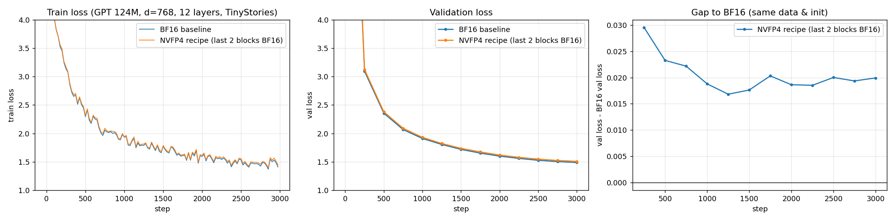
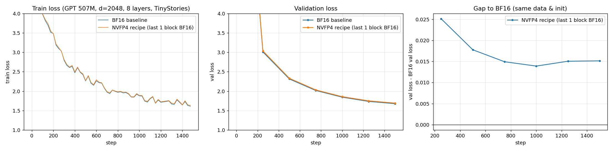

# Results

All results were measured on one machine on 2026-11-21/22:

- **GPU:** NVIDIA GeForce RTX 5090 **Laptop** GPU (GB203, 82 SMs, 24 GB, ~896 GB/s, 64 MB L2, ~175 W board power)
- **Driver:** 595.79 (Windows 11), running in WSL2 Ubuntu 22.04
- **Software:** CUDA 13.0, PyTorch 2.14.1+cu130

There are two versions of the stack. **v0.1** quantized each operand with a separate kernel and
saved BF16 activations for backward. **v0.2** (current) adds the fused dual quantizer, saves only
NVFP4 operands, uses the hardware E2M1 convert, and can fuse the wgrad accumulation into the GEMM
(see [DESIGN.md §3–4](DESIGN.md)). Tables give v0.1 numbers wherever they changed.

Raw data sits next to each table: `bench/results/*.json` and `experiments/results/**`.
Every benchmark checks correctness against the fp64 reference before timing. Timings are the
median of 7 trials, each a batch of back-to-back launches (see `bench/bench_gemm.py::timeit` for why
per-launch syncing is misleading on a laptop GPU). This is one laptop with real thermal and power
behaviour; expect about 5–10% run-to-run variation.

## 1. GEMM throughput (TFLOPS, `bench/results/gemm.json`)

| M × N × K | BF16 cuBLAS | **NVFP4, this repo** | this repo incl. quantizing both operands | NVFP4 cuBLASLt (`torch._scaled_mm`) | ours / BF16 | ours / cuBLASLt |
|---|---|---|---|---|---|---|
| 2048³ | 86 | **264** | 172 | 228 | 3.07× | 1.16 |
| 4096³ | 94 | **343** | 250 | 343 | 3.66× | 1.00 |
| 8192³ | 88 | **362** | 275 | 419 | 4.10× | 0.86 |
| 8192×8192×2048 | 99 | **333** | 281 | 248 | 3.35× | 1.34 |
| 8192×2048×8192 | 94 | **355** | 215 | 386 | 3.79× | 0.92 |
| 2048×8192×8192 | 93 | **361** | 220 | 338 | 3.90× | 1.07 |
| 8192×3072×768 | 92 | **283** | 186 | 141 | 3.08× | 2.01 |
| 8192×768×3072 | 93 | **328** | 116 | 336 | 3.52× | 0.98 |
| 768×3072×8192 | 89 | **343** | 127 | 398 | 3.86× | 0.86 |

- **Against BF16:** the NVFP4 kernel runs **3.1–4.1× faster than BF16 cuBLAS**.
- **Against cuBLASLt NVFP4:** it is faster on short-K shapes (up to 2×) and reaches about 86% of
  cuBLASLt on the longest-K shapes.
- **Output agreement:** cuBLASLt and our output agree within bf16 rounding (max |Δ| / max |D| ≈ 0.4–0.9%).
  Ours matches the fp64 reference to about 1e-7.
- **The v0.2 accumulate epilogue** (`gemm(..., out=g, accumulate=True)`) raised register use from
  130 to 150 with no spills, and the plain GEMM didn't slow down (this table vs v0.1: within ±3%).
- **Hardware ceiling:** NVIDIA's dense FP4 peak for the *desktop* RTX 5090 is 1676 TFLOPS. The
  laptop part has fewer than half its SMs and a 175 W board limit.
- **Pipeline variants:** GEMM pipeline variants (`bench/results/gemm_variants.txt`) gave no
  consistent winner, so the default stays 4 stages with 1 CTA per SM.

## 2. Quantizer (`bench/results/quantize.json`)

### 2.1 Fused dual quantizer vs the separate calls it replaces

Each case produces exactly the operand pair NVFP4Linear needs, so the outputs are bit-identical
(`tests/test_quantize_dual_cuda.py`). "Separate" is two single-output calls plus the row padding.

| Role in NVFP4Linear | Tensor | separate | **fused** | speedup |
|---|---|---|---|---|
| activation: X (RNE) + Xᵀ (RHT, padded to 128) | 8192 × 768 bf16 | 65.7 µs | **32.0 µs** | **2.05×** |
| | 8192 × 3072 bf16 | 351.8 µs | **146.4 µs** | **2.40×** |
| gradient: dY (SR) + dYᵀ (RHT + SR, padded) | 8192 × 2304 bf16 | 284.6 µs | **188.6 µs** | **1.51×** |
| | 8192 × 8192 bf16 | 1206 µs | **648 µs** | **1.86×** |
| weight: W + Wᵀ (16×16 2D blocks) | 3072 × 768 fp32 | 52.8 µs | **21.8 µs** | **2.43×** |
| | 8192 × 2048 fp32 | 282.1 µs | **182.1 µs** | **1.55×** |

### 2.2 Single-output quantizer

Effective GB/s counts one input read plus the NVFP4 output. The input is read twice (amax, then
quantize). An 8192 × 2048 bf16 tensor (32 MB) fits in the 64 MB L2, so its first row exceeds DRAM
bandwidth; the 8192² row (128 MB) is the DRAM-bound case.

| Tensor | rowwise | rowwise, 16×16 2D | transposed | transposed + RHT + SR (wgrad) | rowwise + SR |
|---|---|---|---|---|---|
| 8192 × 2048 bf16 | **1385 GB/s (31 µs)** — v0.1: 725 | 562 (v0.1: 470) | 630 (v0.1: 503) | 513 (v0.1: 254) | 641 |
| 8192 × 8192 bf16 | 480 GB/s (358 µs) — v0.1: 488 | 195 (v0.1: 191) | 426 (v0.1: 406) | 363 (v0.1: 225) | 420 |
| 768 × 8192 bf16 | 694 GB/s (23 µs) | 391 | 475 | 418 | 483 |

Most of the single-output gain came from the hardware `cvt.rn.satfinite.e2m1x2` convert, a
division-free stochastic-rounding path and per-CTA amax reduction (DESIGN.md §3.2–3.3).

## 3. Transformer-block training step vs width (`bench/results/train_step.json`)

This measures one pre-LN GPT block (qkv, SDPA attention, out-proj and a 4× MLP), forward and
backward, on 8192 tokens with BF16 autocast. The four linears either run on NVFP4Linear or stay
BF16. LayerNorm, attention and GELU are BF16 in both cases. Peak memory is the extra CUDA memory
allocated during the step.

| d_model | BF16 step | NVFP4 step | **speedup** (v0.1) | effective linear TFLOPS, BF16 → NVFP4 | peak MiB, BF16 → NVFP4 |
|---|---|---|---|---|---|
| 768 | 6.19 ms | 3.74 ms | **1.66×** (1.29×) | 56 → 93 | 461 → 421 |
| 1024 | 10.16 ms | 5.61 ms | **1.81×** (1.44×) | 61 → 110 | 624 → 563 |
| 2048 | 34.01 ms | 15.80 ms | **2.15×** (1.76×) | 73 → 157 | 1441 → 1293 |
| 3072 | 79.22 ms | 33.01 ms | **2.40×** (2.04×) | 70 → 169 | 2513 → 2263 |
| 4096 | 135.03 ms | 53.20 ms | **2.54×** (2.13×) | 73 → 186 | 3841 → 3472 |

- **Why it improved:** fused quantization roughly halves quantizer time, and backward no longer
  re-reads saved BF16 activations. At d=768 the block's device time fell from 4.24 to 3.19 ms.
- **Why memory dropped:** a linear now saves Xᵀ and Wᵀ in NVFP4 (~0.56 bytes/element) instead of
  BF16 X.
- **Fused wgrad accumulation** (`nvfp4_fused_wgrad_ms` in the JSON) is within run-to-run noise of
  the default here: 3.71 / 5.55 / 15.31 / 33.42 / 54.32 ms. The profiler shows it removes the
  separate gradient add (−0.6 ms at d=2048) but the fp32-output GEMM costs +0.25 ms, so it's a net
  1–3% at best. It is opt-in (`NVFP4Linear(..., fuse_wgrad_accumulation=True)`).

## 4. End-to-end pretraining: GPT-124M, BF16 vs NVFP4 (`experiments/results/`, `experiments/results/v0.2/`)

**Setup**

- **Model:** GPT-2-small-shaped, 124M parameters (d=768, 12 layers, 12 heads, context 512, tied
  embeddings).
- **Data:** TinyStoriesV2 (first 250 MB, 63.7M GPT-2 tokens).
- **Schedule:** 3000 steps × 16,384 tokens (49M tokens), AdamW (0.9, 0.95, wd 0.1), lr 6e-4 with
  cosine decay to 10%, 200 warm-up steps, gradient clipping at 1.0.
- **Controls:** the same seed, initialization and data order in every run. Validation uses 40
  fixed batches.

**Runs**

- **NVFP4 recipe:** every block linear (qkv, out-proj, fc1, fc2) trains in NVFP4, except in the last
  two blocks (40 of 48 linears). The v0.2 run also uses fused wgrad accumulation.
- **Ablations (v0.1):** "all blocks" puts all 48 in NVFP4. "No RHT" disables the wgrad Hadamard transform.



| Run | final val loss | Δ vs BF16 | median tokens/s | GPU energy / 1k tokens | wall time | peak memory |
|---|---|---|---|---|---|---|
| BF16 (autocast), v0.2 rerun | **1.4892** | — | 63,312 | 2.72 J | 797 s | 10.12 GB |
| **NVFP4 recipe, v0.2** | 1.5092 | +0.020 (+1.3%) | **78,727 (+24.3%)** | **2.18 J (−19.9%)** | **641 s** | **9.55 GB** |
| BF16 (autocast), v0.1 run | 1.4884 | — | 63,290 | 2.85 J | 798 s | — |
| NVFP4 recipe, v0.1 | 1.5064 | +0.018 (+1.2%) | 70,086 (+10.7%) | 2.44 J (−14.5%) | 718 s | — |
| NVFP4, all blocks, v0.1 | 1.5087 | +0.020 | 71,531 (+13.0%) | 2.39 J (−16.2%) | 703 s | — |
| NVFP4, no wgrad RHT, v0.1 | 1.5075 | +0.019 | 70,526 | 2.43 J | 714 s | — |

Peak GPU temperature was 76–78 °C in every run (guard limit 87 °C).

**What this shows**

- **Training is stable.** NVFP4 tracks BF16 from the first steps to the end, with no instability,
  no loss spikes and no divergence.
- **The quality gap is constant.** In v0.2 it stays within +0.017 to +0.020 nats at every
  evaluation from step 250 to step 3000 (v0.1: +0.016 to +0.019), so it doesn't grow with training.
  The v0.1 and v0.2 NVFP4 runs differ by 0.003, about what repeating the identical BF16 run gives
  (0.0008) plus different RHT/SR seeds (v0.2 draws the RHT seed in forward).
- **v0.2 kernels made NVFP4 training 12% faster end to end** (70.1k → 78.7k tokens/s), bringing the
  gain over BF16 from +10.7% to **+24.3%**, with 20% less GPU energy and 0.6 GB less memory.
- **At equal wall-clock time NVFP4 is ahead.** When the NVFP4 run finished (641 s), BF16 was at
  ≈1.540 val loss (interpolated), 0.031 worse than NVFP4's 1.509.
- **Keeping the last two blocks in BF16** recovers about 0.002 of the gap, roughly 10% (v0.1 ablation).
- **The wgrad RHT is not measurable here.** At this scale its effect (0.001) is below what one run
  per configuration can resolve. NVIDIA reports that it matters for much larger models and longer
  runs, where outlier-heavy gradients appear. We don't claim a benefit we didn't measure.
- **Why the end-to-end gain is smaller than §3:** at d=768, the BF16 LM head (50304×768),
  attention, LayerNorms, embeddings, optimizer and the two BF16 blocks are a large share of the step.

## 5. End-to-end pretraining: GPT-507M, d=2048 (`experiments/results/v0.2_wide/`)

This run tests the claim from §3 that wider models gain more.

**Setup**

- **Model:** 507M parameters (d=2048, 8 layers, 16 heads, context 512, tied embeddings).
- **Data and controls:** as in §4.
- **Schedule:** 1500 steps × 16,384 tokens (24.6M tokens), micro-batch 8 with 4-step gradient
  accumulation, lr 3e-4 with cosine decay, 150 warm-up steps.
- **NVFP4 run:** the last block stays BF16 (28 of 32 linears in NVFP4), with fused wgrad accumulation.



| Run | final val loss | Δ vs BF16 | median tokens/s | GPU energy / 1k tokens | wall time | peak memory |
|---|---|---|---|---|---|---|
| BF16 (autocast) | **1.6786** | — | 19,983 | 8.58 J | 1246 s | 13.55 GB |
| **NVFP4 recipe** | 1.6937 | +0.015 (+0.9%) | **31,124 (1.56×)** | **5.48 J (−36.1%)** | **800 s** | **12.63 GB** |

- **The speedup grows with width as predicted:** 1.56× end to end at d=2048 vs 1.24× at d=768.
- **The gap narrows rather than grows:** +0.025 at step 250, then +0.014 to +0.015 from step 750 to the end.
- **At equal wall-clock time NVFP4 is far ahead.** At 800 s, BF16 was at ≈1.872 val loss
  (interpolated) vs NVFP4's 1.694. BF16 needed 1246 s to reach a loss 0.015 lower.
- **The end-to-end gain is smaller than the block benchmark's 2.15×** because the micro-batch is
  4096 tokens (vs 8192 in §3) and the LM head, attention, embeddings, optimizer and last block stay BF16.

**Caveats (§4 and §5)**

- One seed per configuration, one small dataset. The 507M run is far from compute-optimal (24.6M
  tokens, ~0.05 tokens per parameter) and its learning rate wasn't tuned.
- The gap could be narrowed with known techniques that this repo doesn't implement yet, such as
  BF16 "healing" for the last few percent of tokens.
- Results on a desktop RTX 5090, which has twice the SMs and three times the power budget, will
  differ.

## Reproduce

```bash
tools/setup_wsl.sh                       # CUDA 13.0 toolkit + PyTorch cu130 venv (WSL2/Ubuntu 22.04)
tools/check.sh bench                     # build, 164 tests, GEMM + quantizer benchmarks
python bench/bench_train_step.py
python experiments/prepare_tinystories.py
experiments/run_main.sh                  # v0.1 runs + ablations (§4)
experiments/run_v02.sh                   # v0.2 d=768 and d=2048 runs (§4, §5)
python experiments/plot.py experiments/results/v0.2
```
