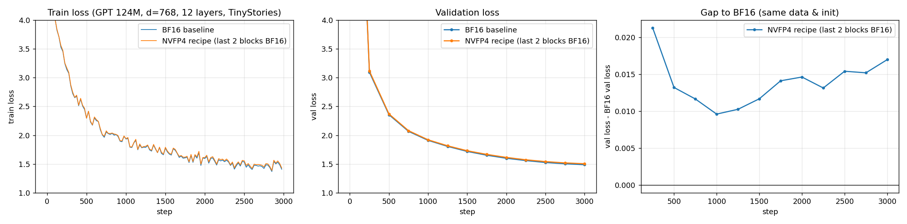

# Results

All results were measured on one machine on 2026-11-21/23:

- **GPU:** NVIDIA GeForce RTX 5090 **Laptop** GPU (GB203, 82 SMs, 24 GB, ~896 GB/s, 64 MB L2, ~175 W board power)
- **Driver:** 595.79 (Windows 11), running in WSL2 Ubuntu 22.04
- **Software:** CUDA 13.0, PyTorch 2.14.1+cu130

There are three versions of the stack ([DESIGN.md](DESIGN.md) has the details):

- **v0.1** quantized each operand with a separate kernel and saved BF16 activations for backward.
- **v0.2** added the fused dual quantizer (one read per operand), NVFP4-saved activations, the
  hardware E2M1 convert and optional fused wgrad accumulation.
- **v0.3** adds the TMA GEMM main loop, split-K for small output grids, and LayerNorm /
  GELU / GELU-backward fused into quantization.
- **v0.7** adds the weight-quantization cache and fused Llama-style blocks (§3.1–3.2).
- **v0.8** (current) makes the TMA GEMM persistent (the pipeline carries across output tiles, refills
  start the moment a stage is free), fuses the residual adds, biases and the q/k/v hand-off (GEMM
  epilogue, in-place multi-part quantization, a LayerNorm / RMSNorm backward kernel that adds the
  residual gradient) and halves the stochastic-rounding hash work. §1 and §3 are v0.8 numbers.
- **v0.4 – v0.6** did not change the kernels' speed: v0.4 hardened them (NaN propagation,
  checks, sanitizers), v0.5 moved the rounding seeds to the GPU and integrated the layers with
  `torch.compile`, CUDA graphs, DDP and FSDP2. v0.5 adds a three-seed quality study (§4.1).

Raw data sits next to each table: `bench/results/*.json` and `experiments/results/**`.
Every benchmark checks correctness against the fp64 reference before timing. Timings are the
median of 7 trials, each a batch of back-to-back launches (see `bench/bench_gemm.py::timeit` for why
per-launch syncing is misleading on a laptop GPU). This is one laptop at its power limit; expect
about 5–10% run-to-run variation, more for cuBLASLt (the same shape measured 334–418 TFLOPS on
different runs).

## 1. GEMM throughput (TFLOPS, `bench/results/gemm.json`)

| M × N × K | BF16 cuBLAS | **NVFP4, this repo (v0.8)** | v0.7 | v0.2 main loop (cp.async) | incl. quantizing both operands | NVFP4 cuBLASLt (`torch._scaled_mm`) | ours / BF16 | ours / cuBLASLt |
|---|---|---|---|---|---|---|---|---|
| 2048³ | 86 | **293** | 289 | 258 | 189 | 237 | 3.42× | 1.24 |
| 4096³ | 93 | **406** | 385 | 336 | 282 | 338 | 4.38× | 1.20 |
| 8192³ | 89 | **441** | 410 | 375 | 310 | 427 | 4.97× | 1.03 |
| 8192×8192×2048 | 99 | **392** | 364 | 321 | 321 | 215 | 3.95× | 1.82 |
| 8192×2048×8192 | 93 | **425** | 401 | 347 | 239 | 341 | 4.59× | 1.25 |
| 2048×8192×8192 | 92 | **432** | 407 | 356 | 244 | 334 | 4.69× | 1.29 |
| 8192×3072×768 | 87 | **275** | 277 | 256 | 180 | 139 | 3.14× | 1.98 |
| 8192×768×3072 | 92 | **397** | 390 | 323 | 122 | 334 | 4.33× | 1.19 |
| 768×3072×8192 | 85 | **414** | 393 | 341 | 134 | 393 | 4.86× | 1.05 |
| 768×768×8192 (split-K) | 84 | **273** | 266 | 218 | 128 | 214 | 3.26× | 1.28 |
| 2304×768×8192 | 95 | **313** | 308 | 276 | 19\* | 344 | 3.31× | 0.91 |

\* An outlier (it was in v0.7's run too): quantizing the two operands takes ~37 + 21 µs on their own,
so this column should read about 190 TFLOPS.

- **v0.8's persistent main loop** is up to 8% faster than v0.7 at the power limit (8192³: 441 vs 410, now
  above cuBLASLt's 427) and spends 8–17% fewer cycles at locked clocks; the accumulating wgrad GEMM
  (not in this table: `D += A·B^T` into an fp32 gradient) is 3–28% faster
  ([DESIGN.md §4.2](DESIGN.md)).
- **v0.3 closed the long-K gap to cuBLASLt** (v0.2 reached about 86% of it). How:
  [DESIGN.md §4.1](DESIGN.md).
- **The TMA loop is 7–25% faster than the v0.2 loop** on every shape it handles (K ≥ 1024, and from
  K = 512 when there are at least 8 output tiles per SM).
- **Split-K** lifts the 36-tile 768×768×8192 wgrad from 218 to 273 TFLOPS (+25%).
- **Against BF16:** 3.1–5.0× BF16 cuBLAS; against cuBLASLt NVFP4: 0.91–1.98×, below it only on
  2304×768×8192.
- **Locked-clock caveat:** at equal (profiler-locked) clocks cuBLASLt's kernel still takes fewer cycles
  (8192³: 3.65M vs 4.64M, tensor pipe ~90% vs 71%; v0.7: 5.10M, 64%). At the power limit, where
  training runs, that does not show ([DESIGN.md §4.2](DESIGN.md)).
- **Output agreement:** cuBLASLt and our output agree within bf16 rounding (max |Δ| / max |D| ≈ 0.4–0.7%).
  Ours matches the fp64 reference to about 1e-7.
- **Hardware ceiling:** NVIDIA's dense FP4 peak for the *desktop* RTX 5090 is 1676 TFLOPS. The
  laptop part has fewer than half its SMs and a 175 W board limit.

## 2. Quantizer (`bench/results/quantize.json`)

### 2.1 Fused dual quantizer vs the separate calls it replaces

Each case produces exactly the operand pair NVFP4Linear needs, so the outputs are bit-identical
(`tests/test_quantize_dual_cuda.py`). "Separate" is two single-output calls plus the row padding.

| Role in NVFP4Linear | Tensor | separate | **fused** | speedup |
|---|---|---|---|---|
| activation: X (RNE) + Xᵀ (RHT, padded to 128) | 8192 × 768 bf16 | 70.1 µs | **36.0 µs** | **1.95×** |
| | 8192 × 3072 bf16 | 362.4 µs | **157.3 µs** | **2.30×** |
| gradient: dY (SR) + dYᵀ (RHT + SR, padded) | 8192 × 2304 bf16 | 311.2 µs | **166.4 µs** | **1.87×** |
| | 8192 × 8192 bf16 | 1155 µs | **609 µs** | **1.90×** |
| weight: W + Wᵀ (16×16 2D blocks) | 3072 × 768 fp32 | 57.5 µs | **25.8 µs** | **2.23×** |
| | 8192 × 2048 fp32 | 290.3 µs | **182.5 µs** | **1.59×** |

v0.8's paired stochastic-rounding hash ([DESIGN.md §3.2](DESIGN.md)) made the gradient case 5–6%
faster than v0.7 (173 → 166 µs, 648 → 609 µs); measured in isolation, SR now adds 34–43% to the dual
quantizer instead of 48–61%, and 5–6% to the fused SwiGLU-backward quantizer instead of 9–11%.

### 2.2 Single-output quantizer

Effective GB/s counts one input read plus the NVFP4 output. The input is read twice (amax, then
quantize). An 8192 × 2048 bf16 tensor (32 MB) fits in the 64 MB L2, so its first row exceeds DRAM
bandwidth; the 8192² row (128 MB) is the DRAM-bound case.

| Tensor | rowwise | rowwise, 16×16 2D | transposed | transposed + RHT + SR (wgrad) | rowwise + SR |
|---|---|---|---|---|---|
| 8192 × 2048 bf16 | **1305 GB/s (33 µs)** — v0.1: 725 | 549 (v0.1: 470) | 613 (v0.1: 503) | 485 (v0.1: 254) | 709 (v0.7: 622) |
| 8192 × 8192 bf16 | 476 GB/s (361 µs) — v0.1: 488 | 198 (v0.1: 191) | 421 (v0.1: 406) | 367 (v0.1: 225) | 453 (v0.7: 408) |
| 768 × 8192 bf16 | 678 GB/s (24 µs) | 362 | 475 | 404 | 528 (v0.7: 467) |

Most of the gain over v0.1 came from the hardware `cvt.rn.satfinite.e2m1x2` convert, a
division-free stochastic-rounding path and per-CTA amax reduction (DESIGN.md §3.2–3.3).

### 2.3 LayerNorm and GELU fused into quantization (v0.3)

Device time of one d=768 / d=2048 block step (8192 tokens, profiler), same NVFP4 GEMMs, with and
without the producer fusion of [DESIGN.md §3.4](DESIGN.md):

| d_model | unfused | **LayerNorm / GELU / GELU-backward fused** | peak memory |
|---|---|---|---|
| 768 | 3.13 ms | **3.00 ms (−4%)** | 357 → 363 MiB |
| 2048 | 14.52 ms | **13.40 ms (−8%)** | 1229 → 1219 MiB |

Gone from the step: the LayerNorm forward kernels, the GELU and GELU-backward kernels, the bf16 copy
of the LayerNorm output, and the separate amax pass over each of those outputs.

## 3. Transformer-block training step vs width (`bench/results/train_step.json`)

This measures one pre-LN GPT block (qkv, SDPA attention, out-proj and a 4× MLP), forward and
backward, on 8192 tokens with BF16 autocast. The four linears either run in NVFP4 or stay BF16;
attention is BF16 SDPA in both. "NVFP4" is NVFP4Linear; "fused" adds the LayerNorm / GELU fusion and
fused wgrad accumulation (the configuration of the v0.3 training runs); "fused + residual" (v0.8) also
hands q / k / v over without a concatenation and fuses both residual adds (`chunks=3`,
`return_residual`, `residual=True`; [DESIGN.md §3.6](DESIGN.md)). Every variant is timed in two passes
in opposite orders and the best is kept (the power-limited GPU slows as it heats up). Peak memory is
the extra CUDA memory allocated during the step.

| d_model | BF16 step | NVFP4 | fused | **fused + residual** | **speedup** (fused / NVFP4) | linear TFLOPS, BF16 → NVFP4 | peak MiB, BF16 → fused + residual |
|---|---|---|---|---|---|---|---|
| 768 | 6.24 ms | 3.74 ms | 3.50 ms | **3.43 ms** | **1.82×** (1.78× / 1.67×) | 56 → 93 | 461 → 438 |
| 1024 | 10.30 ms | 5.49 ms | 5.05 ms | **4.92 ms** | **2.09×** (2.04× / 1.87×) | 60 → 113 | 624 → 588 |
| 2048 | 34.67 ms | 15.58 ms | 13.69 ms | **13.07 ms** | **2.65×** (2.53× / 2.23×) | 71 → 159 | 1441 → 1315 |
| 3072 | 79.57 ms | 29.18 ms | 27.62 ms | **25.07 ms** | **3.17×** (2.88× / 2.73×) | 70 → 191 | 2513 → 2248 |
| 4096 | 135.57 ms | 46.11 ms | 42.89 ms | **42.14 ms** | **3.22×** (3.16× / 2.94×) | 73 → 215 | 3841 → 3387 |

v0.7 measured 1.80× / 1.96× / 2.40× / 2.97× / 2.88× for "fused" at the same widths (v0.3: up to
3.10× at d=4096 in a cooler session); the v0.8 GEMM and quantizer changes lift every NVFP4 column.
The residual fusion uses 1–3% more peak memory than "fused" (the fp32 residual-stream gradient is
held while the norm backward runs).

- **Split-K's share** at d=768 (where the 768×768 projection wgrad splits): 3.64 ms with
  `NVFP4_GEMM_SPLITS=1` vs 3.60 ms auto, about 1% of the step.
- **Why the benefit grows with width:** GEMM time grows as d², while the quantization passes and the
  BF16 parts (attention, norms) grow more slowly.

### 3.1 Weight-quantization cache (v0.7, `bench_train_step.py`, `nvfp4_fused_cached`)

With `cache_weight_quantization=True` the NVFP4 copies of a weight are reused until an optimizer
step (or any other change) touches it, so under gradient accumulation every micro-batch after the
first skips the weight quantizer. The table is the steady state of such a micro-batch (same session):

| d_model | fused + residual | + weight cache | saved | speedup vs BF16 | peak MiB |
|---|---|---|---|---|---|
| 768 | 3.43 ms | 3.33 ms | 2.8% | 1.82× → 1.87× | 438 → 444 |
| 1024 | 4.92 ms | 4.77 ms | 3.0% | 2.09× → 2.16× | 588 → 594 |
| 2048 | 13.07 ms | 12.96 ms | 0.8% | 2.65× → 2.67× | 1315 → 1342 |
| 3072 | 25.07 ms | 23.82 ms | 5.0% | 3.17× → 3.34× | 2248 → 2310 |
| 4096 | 42.14 ms | 38.78 ms | 8.0% | 3.22× → **3.50×** | 3387 → 3496 |

The cached copies cost ~1.1 bytes per weight element.

### 3.2 Llama-style block (v0.7–v0.8, `bench/results/llama_block.json`)

One Llama-style block: RMSNorm, qkv, causal SDPA, o_proj, RMSNorm and a SwiGLU MLP (hidden ≈ 8/3·d,
rounded to 256), forward and backward on 8192 tokens with BF16 autocast. "NVFP4" converts the five
linears; "fused" uses `rmsnorm_linear` / `rmsnorm_swiglu_mlp` (RMSNorm and SwiGLU and its backward
inside the quantizers, one quantization of the normalized input shared by gate and up, fused wgrad
accumulation; the v0.7 API); "fused + residual" adds the v0.8 fusions (q / k / v chunks, residual
handle into the o_proj epilogue, `residual=True` MLP); "+ cache" adds the weight cache (micro-batches
after the first). Two passes in opposite orders, best kept.

| d_model (hidden) | BF16 step | NVFP4 | fused | **fused + residual** | **+ cache** | peak MiB, BF16 → NVFP4 → fused → + residual |
|---|---|---|---|---|---|---|
| 1024 (2816) | 11.05 ms | 6.48 ms (1.70×) | 5.68 ms (1.95×) | **5.29 ms (2.09×)** | **5.14 ms (2.15×)** | 688 → 648 → 601 → 618 |
| 2048 (5632) | 39.28 ms | 17.82 ms (2.20×) | 14.85 ms (2.64×) | **13.71 ms (2.87×)** | **13.12 ms (2.99×)** | 1541 → 1426 → 1330 → 1361 |
| 3072 (8192) | 80.83 ms | 32.03 ms (2.52×) | 28.75 ms (2.81×) | **26.39 ms (3.06×)** | **23.99 ms (3.37×)** | 2601 → 2374 → 2243 → 2291 |
| 4096 (11008) | 141.50 ms | 50.15 ms (2.82×) | 45.43 ms (3.11×) | **42.58 ms (3.32×)** | **38.91 ms (3.64×)** | 3965 → 3569 → 3395 → 3459 |

- v0.7 measured 1.88× / 2.60× / 2.83× / 2.96× for "fused" and up to 3.13× with the cache.
- The residual fusion saves 6–8% over "fused": at d=4096 it removes ~3.4 ms of the 0.7 step's 39.4 ms
  of GPU time (the q / k / v gradient stack and copy, both residual adds, the residual-gradient sums
  and a bf16 cast; [DESIGN.md §3.6](DESIGN.md)).
- The first v0.7 version was no faster than unfused: its RMSNorm backward was ~10 separate fp32
  PyTorch ops. v0.7 used PyTorch's fused RMSNorm-backward kernel; v0.8 replaces it with its own kernel
  that also produces dw and adds the residual gradient in the same pass.

## 4. End-to-end pretraining: GPT-124M (`experiments/results/`, `…/v0.2/`, `…/v0.3/`)

**Setup**

- **Model:** GPT-2-small-shaped, 124M parameters (d=768, 12 layers, 12 heads, context 512, tied
  embeddings).
- **Data:** TinyStoriesV2 (first 250 MB, 63.7M GPT-2 tokens).
- **Schedule:** 3000 steps × 16,384 tokens (49M tokens), AdamW (0.9, 0.95, wd 0.1), lr 6e-4 with
  cosine decay to 10%, 200 warm-up steps, gradient clipping at 1.0.
- **Controls:** the same seed, initialization and data order in every run. Validation uses 40
  fixed batches.

**Runs**

- **NVFP4 recipe:** every block linear (qkv, out-proj, fc1, fc2) trains in NVFP4, except in the last
  two blocks (40 of 48 linears). v0.2 adds fused wgrad accumulation; v0.3 also fuses LayerNorm/GELU.
- **Ablations (v0.1):** "all blocks" puts all 48 in NVFP4. "No RHT" disables the wgrad Hadamard transform.
- **Baselines:** the BF16 code path is the same in all versions; v0.3 reuses the v0.2 BF16 run.



| Run | final val loss | Δ vs BF16 | median tokens/s | GPU energy / 1k tokens | wall time | peak memory |
|---|---|---|---|---|---|---|
| BF16 (autocast), v0.2 run | **1.4892** | — | 63,312 | 2.77 J | 797 s | 10.12 GB |
| **NVFP4 recipe, v0.3** | 1.5062 | +0.017 (+1.1%) | **80,526 (+27.2%)** | **2.17 J (−21.6%)** | **627 s** | **9.55 GB** |
| NVFP4 recipe, v0.2 | 1.5092 | +0.020 (+1.3%) | 78,727 (+24.3%) | 2.22 J (−19.8%) | 641 s | 9.55 GB |
| BF16 (autocast), v0.1 run | 1.4884 | — | 63,290 | 2.78 J | 798 s | 10.12 GB |
| NVFP4 recipe, v0.1 | 1.5064 | +0.018 (+1.2%) | 70,086 (+10.7%) | 2.49 J (−10.3%) | 718 s | 9.97 GB |
| NVFP4, all blocks, v0.1 | 1.5087 | +0.020 | 71,531 (+13.0%) | 2.44 J (−12.0%) | 703 s | 9.94 GB |
| NVFP4, no wgrad RHT, v0.1 | 1.5075 | +0.019 | 70,526 | 2.48 J | 714 s | 9.97 GB |

Peak GPU temperature was 76–78 °C in every run. GPU energy integrates the guard's power samples over
their actual timestamps; until v0.3 the integration assumed the first sampling interval for all
samples, which put the v0.1 savings at −14.5% instead of −10.3% (all rows above use the corrected
method).

**What this shows**

- **Training is stable.** NVFP4 tracks BF16 from the first steps to the end, with no instability,
  no loss spikes and no divergence.
- **The quality gap is constant.** In v0.3 it stays between +0.010 and +0.021 nats at every
  evaluation (v0.2: +0.017 to +0.020, v0.1: +0.016 to +0.019), so it doesn't grow with training.
  The fused LayerNorm/GELU path did not change it: differences between versions (0.003) are about
  what repeating the identical BF16 run gives (0.0008) plus different RHT/SR seeds.
- **v0.3 is 15% faster than v0.1 end to end** (70.1k → 80.5k tokens/s): +27% over BF16 with 22% less
  GPU energy. Most of the v0.2 → v0.3 gain is at larger widths (§5); at d=768 the BF16 LM head,
  attention and the two BF16 blocks dominate what is left.
- **At equal wall-clock time NVFP4 is ahead.** When the v0.3 NVFP4 run finished (627 s), BF16 was at
  ≈1.547 val loss (interpolated), 0.040 worse than NVFP4's 1.506.
- **Keeping the last two blocks in BF16** recovers about 0.002 of the gap, roughly 10% (v0.1 ablation).
- **The wgrad RHT is not measurable here.** At this scale its effect (0.001) is below what one run
  per configuration can resolve. NVIDIA reports that it matters for much larger models and longer
  runs, where outlier-heavy gradients appear. We don't claim a benefit we didn't measure.

### 4.1 Three seeds (v0.5, `experiments/results/v0.5_seeds/`)

The comparison above uses one seed. To check that the gap is not luck, the same setup was repeated
with seeds 0, 1 and 2 for both precisions (`experiments/run_v05_seeds.sh`; the seed changes the
initialization, the data order and the rounding seeds). NVFP4 runs use the v0.5 stack with fused
wgrad accumulation and fused producers; seed 0 of BF16 is the v0.2 BF16 run above.


| seed | BF16 val loss | NVFP4 val loss | gap (same seed) | BF16 tokens/s | NVFP4 tokens/s |
|---|---|---|---|---|---|
| 0 | 1.4892 | 1.5068 | +0.0176 (+1.18%) | 63,295 | 80,624 |
| 1 | 1.4922 | 1.5112 | +0.0189 (+1.27%) | 63,018 | 80,575 |
| 2 | 1.4892 | 1.5100 | +0.0209 (+1.40%) | 63,045 | 80,524 |
| **mean ± std** | 1.4902 ± 0.0018 | 1.5093 ± 0.0023 | **+0.0191 ± 0.0016 (+1.28%)** | 63,119 | **80,574 (+27.7%)** |

- **The gap is reproducible:** +0.018 to +0.021 for every seed, a standard deviation of 0.0016 across
  seeds. It is about ten times the seed-to-seed spread of either precision alone, so it is a real,
  small cost of the format, not noise; and it is consistent with every earlier single-seed run
  (+0.017 to +0.020).
- **It stays constant during training** for all three seeds (right panel): after the first 1000
  steps it moves within +0.014 to +0.021 and does not grow.
- **Throughput is stable:** +27.7% tokens/s for NVFP4 on every seed (spread under 0.2%), the same as
  v0.3's single run, so v0.5's integration work cost no end-to-end speed.
- Peak GPU temperature 76–79 °C; each NVFP4 run took 630 s, each BF16 run 805 s.

**v0.8 rerun of seed 0** (`experiments/results/v0.8/`, residual-fused blocks, paired stochastic
rounding, persistent GEMM): validation loss **1.5073** after 3000 steps vs v0.5's 1.5068 for the same
seed (BF16: 1.4892), i.e. within the seed spread; 82.4k tokens/s vs 80.6k (+2.2% at this width,
where the block step is small and attention / embeddings / the LM head are a large share); 613 s.

## 5. End-to-end pretraining: GPT-507M, d=2048 (`experiments/results/v0.2_wide/`, `…/v0.3_wide/`)

This run tests the claim from §3 that wider models gain more.

**Setup**

- **Model:** 507M parameters (d=2048, 8 layers, 16 heads, context 512, tied embeddings).
- **Data and controls:** as in §4.
- **Schedule:** 1500 steps × 16,384 tokens (24.6M tokens), micro-batch 8 with 4-step gradient
  accumulation, lr 3e-4 with cosine decay, 150 warm-up steps.
- **NVFP4 runs:** the last block stays BF16 (28 of 32 linears in NVFP4), with fused wgrad
  accumulation; v0.3 also fuses LayerNorm/GELU.


| Run | final val loss | Δ vs BF16 | median tokens/s | GPU energy / 1k tokens | wall time | peak memory |
|---|---|---|---|---|---|---|
| BF16 (autocast) | **1.6786** | — | 19,983 | 8.76 J | 1246 s | 13.55 GB |
| **NVFP4 recipe, v0.3** | 1.6954 | +0.017 (+1.0%) | **32,328 (1.62×)** | **5.38 J (−38.6%)** | **770 s** | **12.63 GB** |
| NVFP4 recipe, v0.2 | 1.6937 | +0.015 (+0.9%) | 31,124 (1.56×) | 5.60 J (−36.1%) | 800 s | 12.63 GB |

- **The speedup grows with width as predicted:** 1.62× end to end at d=2048 vs 1.27× at d=768.
- **The gap does not grow:** +0.023 at step 250, then +0.007 to +0.019 to the end (v0.2: +0.025,
  then +0.014 to +0.015).
- **At equal wall-clock time NVFP4 is far ahead.** At 770 s, BF16 was at ≈1.897 val loss
  (interpolated) vs NVFP4's 1.695. BF16 needed 1246 s to reach a loss 0.017 lower.
- **The end-to-end gain is smaller than the block benchmark's 2.4×** because the micro-batch is
  4096 tokens (vs 8192 in §3) and the LM head, attention, embeddings, optimizer and last block stay BF16.
- **Stability note.** The first v0.3 attempt of this run stopped at step ~600 with a CUDA "unknown
  error", the WSL symptom of a GPU watchdog reset. The cause was a warp-convergence hazard in the TMA
  GEMM (one lane waiting on a barrier while its warp issued `.aligned` MMA instructions); it was fixed
  and every barrier wait is now bounded (DESIGN.md §4.1). The run above is the complete rerun.

**Caveats (§4 and §5)**

- One seed per configuration, one small dataset. The 507M run is far from compute-optimal (24.6M
  tokens, ~0.05 tokens per parameter) and its learning rate wasn't tuned.
- The gap could be narrowed with known techniques that this repo doesn't implement yet, such as
  BF16 "healing" for the last few percent of tokens.
- Results on a desktop RTX 5090, which has twice the SMs and three times the power budget, will
  differ.

## 6. Desktop RTX 5090 ×2, rented (`experiments/results/rtx5090_desktop_2gpu/`)

One session on 2026-11-23 on a rented Community-Cloud machine: **2× GeForce RTX 5090** (170 SMs, 32 GB,
517 W power limit, up to 3090 MHz), driver 615.71, **CUDA 12.8 and PyTorch 2.11.0+cu128** (older than
the laptop's 13.0 / 2.14.1, so this also checks the build on another toolchain). v0.8.0 as released;
`tools/pod_session.sh` ran everything unattended.

**Correctness.** 625 tests passed (12 skipped, the same parametrize exclusions as on the laptop),
including **the five two-GPU NCCL tests across two physical GPUs** (DDP, DDP with bucket views, FSDP1,
FSDP2, weight cache: gradients bit-identical to a single process). compute-sanitizer memcheck,
racecheck, synccheck and initcheck: 0 findings. 5-minute soak: 28,047 iterations, 5,610 bit-exact
replays, 140,235 GEMMs re-checked.

**GEMM (TFLOPS)** — the persistent TMA loop at full desktop power:

| M × N × K | BF16 cuBLAS | **NVFP4, this repo** | NVFP4 cuBLASLt | ours / cuBLASLt |
|---|---|---|---|---|
| 2048³ | 159 | **686** | 520 | 1.32 |
| 4096³ | 167 | **973** | 809 | 1.20 |
| 8192³ | 209 | **1027** | 856 | 1.20 |
| 8192×8192×2048 | 203 | **899** | 549 | 1.64 |
| 8192×2048×8192 | 168 | **987** | 921 | 1.07 |
| 2048×8192×8192 | 169 | **989** | 917 | 1.08 |
| 8192×3072×768 | 183 | **594** | 347 | 1.71 |
| 8192×768×3072 | 123 | **802** | 693 | 1.16 |
| 768×3072×8192 | 183 | **1002** | 923 | 1.09 |
| 768×768×8192 (split-K) | 168 | **381** | 292 | 1.30 |
| 2304×768×8192 | 194 | **796** | 775 | 1.03 |

The locked-clock gap of [DESIGN.md §4.2](DESIGN.md) does **not** show up with the desktop part's power
headroom: the kernel is at or above cuBLASLt on every shape (1.03–1.71×) and reaches 1.03 PFLOPS,
61% of NVIDIA's 1676 TFLOPS dense-FP4 figure for this GPU.

**Block step** (8192 tokens, BF16 autocast, same benchmarks as §3):

| d_model | GPT: BF16 | GPT: fused + residual | + cache | Llama: BF16 | Llama: fused + residual | + cache |
|---|---|---|---|---|---|---|
| 768 / 1024 | 2.91 ms | 2.31 ms (1.26×) | 2.20 ms (1.32×) | 5.67 ms (d=1024) | 2.70 ms (2.10×) | 2.51 ms (2.26×) |
| 2048 | 16.15 ms | 5.43 ms (2.98×) | 5.22 ms (3.09×) | 17.54 ms | 5.75 ms (3.05×) | 5.53 ms (3.17×) |
| 3072 | 32.31 ms | 10.23 ms (3.16×) | 9.70 ms (3.33×) | 34.13 ms | 10.63 ms (3.21×) | 10.09 ms (3.38×) |
| 4096 | 55.66 ms | 17.03 ms (3.27×) | 16.10 ms (3.46×) | 57.75 ms | 17.51 ms (3.30×) | 16.52 ms (3.49×) |

At d = 768–1024 a whole block step takes ~2.3 ms on this GPU and the step is bound by kernel launches
(Python and the dispatcher), so the gain there is small; CUDA-graph capture of the training step
(supported, [USAGE.md §5](USAGE.md)) is the remedy at that size.

**GPT-124M, 3000 steps, one GPU:** NVFP4 val loss **1.5070** vs BF16 **1.4880** (the laptop: 1.5073 vs
1.4892), **192k vs 145k tokens/s (+32%)**.

**Two GPUs, DDP over NCCL:** trains correctly (NVFP4 val 1.5103 after 3000 steps with the global
batch split over two ranks) but at only 56k tokens/s. The machine is the limit: NCCL reported
peer-to-peer disabled between the two cards, all-reduce ran over host shared memory at **2.0 GB/s bus
bandwidth** (`tools/allreduce_probe.py`: 273 ms for 512 MB; a GPT-124M step all-reduces ~500 MB of fp32
gradients), and plain BF16 DDP on the same machine is just as slow (55k vs 145k tokens/s on one GPU;
`pass2/`). Data-parallel scaling on consumer cards needs a host with P2P or fast PCIe between them, or
gradients communicated in lower precision.

## 7. 8-bit attention (v0.9, `bench/results/attention.json`, `long_context.json`, `experiments/results/v0.9/`)

**Kernel speed** (`bench/bench_attention.py`): 16 heads, 16384 tokens per call (batch = 16384 / length),
TFLOPS counting causal attention as half (FlashAttention's convention, fwd+bwd = 3.5× the forward's
FLOPs), autograd path including the quantization passes; PyTorch 2.14 SDPA (flash attention, BF16).

| head dim | tokens / seq | mask | fwd: SDPA | fwd: 8-bit | | fwd+bwd: SDPA | fwd+bwd: 8-bit | |
|---|---|---|---|---|---|---|---|---|
| 128 | 512 | causal | 60 | **41** | 0.67× | 33 | **40** | 1.19× |
| 128 | 512 | full | 78 | **70** | 0.89× | 51 | **56** | 1.10× |
| 128 | 1024 | causal | 65 | **67** | 1.02× | 47 | **61** | 1.28× |
| 128 | 1024 | full | 83 | **103** | 1.24× | 59 | **84** | 1.41× |
| 128 | 2048 | causal | 76 | **100** | 1.33× | 59 | **80** | 1.35× |
| 128 | 2048 | full | 86 | **134** | 1.55× | 71 | **103** | 1.46× |
| 128 | 4096 | causal | 81 | **131** | 1.61× | 70 | **99** | 1.43× |
| 128 | 4096 | full | 87 | **163** | 1.88× | 78 | **117** | 1.50× |
| 128 | 8192 | causal | 84 | **159** | 1.90× | 78 | **115** | 1.48× |
| 128 | 8192 | full | 87 | **189** | 2.18× | 81 | **125** | 1.54× |
| 64 | 512 | causal | 53 | **29** | 0.54× | 27 | **29** | 1.07× |
| 64 | 512 | full | 85 | **52** | 0.61× | 46 | **51** | 1.11× |
| 64 | 1024 | causal | 67 | **56** | 0.84× | 46 | **49** | 1.07× |
| 64 | 1024 | full | 83 | **87** | 1.06× | 63 | **69** | 1.11× |
| 64 | 2048 | causal | 75 | **85** | 1.13× | 60 | **66** | 1.10× |
| 64 | 2048 | full | 86 | **118** | 1.37× | 73 | **84** | 1.15× |
| 64 | 4096 | causal | 79 | **120** | 1.53× | 70 | **80** | 1.14× |
| 64 | 4096 | full | 86 | **147** | 1.70× | 80 | **93** | 1.16× |
| 64 | 8192 | causal | 84 | **133** | 1.59× | 77 | **91** | 1.18× |
| 64 | 8192 | full | 87 | **156** | 1.78× | 83 | **99** | 1.18× |

The 8-bit kernels gain with the sequence length (the quantization pass is a per-token cost) and with
the head dim (the softmax work per score is the same at D = 64, the MMA work half). Below ~1k tokens the
forward alone is slower than flash attention; forward + backward is never slower.

**Training step of a Llama block** (`bench/bench_long_context.py`): d = 2048, 16 heads of 128, SwiGLU,
16384 tokens per step, BF16 vs NVFP4 linears with every fusion and the weight cache, with BF16 or
8-bit attention:

| tokens / seq | BF16 | NVFP4, BF16 attention | **NVFP4 + 8-bit attention** | gain from attention |
|---|---|---|---|---|
| 512 | 75.8 ms | 25.3 ms (3.00×) | **25.1 ms (3.02×)** | 1.01× |
| 1024 | 76.6 ms | 27.4 ms (2.80×) | **26.7 ms (2.87×)** | 1.02× |
| 2048 | 78.5 ms | 30.3 ms (2.59×) | **28.5 ms (2.76×)** | 1.06× |
| 4096 | 84.8 ms | 35.8 ms (2.37×) | **34.0 ms (2.49×)** | 1.05× |
| 8192 | 93.2 ms | 47.3 ms (1.97×) | **38.9 ms (2.40×)** | 1.22× |
| 16384 | 119.3 ms | 71.2 ms (1.67×) | **52.6 ms (2.27×)** | 1.35× |

**Quality** (GPT-124M, TinyStories, 3000 steps, seed 0, `experiments/run_attn8.sh`; 8-bit attention in
every block that has NVFP4 linears, in all blocks for the BF16 run):

| Linears | Attention | Final val loss | tokens/s |
|---|---|---|---|
| BF16 | BF16 (SDPA) | 1.4892 | 63k |
| BF16 | **8-bit** | **1.4892** | 62k |
| NVFP4 (fused) | BF16 (SDPA) | 1.5073 | 82k |
| NVFP4 (fused) | **8-bit** | **1.5095** (+0.14%) | 81k |

The BF16 baseline's seed-to-seed spread is 0.003 (§4.1). At 512 tokens and head dim 64 attention is a
small part of this model's step, so throughput is unchanged; the speed gains are at long context (above).

## Reproduce

```bash
tools/setup_wsl.sh                       # CUDA 13.0 toolkit + PyTorch cu130 venv (WSL2/Ubuntu 22.04)
tools/check.sh bench                     # build, all tests, GEMM + quantizer benchmarks
python bench/bench_train_step.py
python experiments/prepare_tinystories.py
experiments/run_main.sh                  # v0.1 runs + ablations (§4)
experiments/run_v02.sh                   # v0.2 d=768 and d=2048 runs, incl. the BF16 baselines (§4, §5)
experiments/run_v03.sh                   # v0.3 NVFP4 runs (§4, §5)
python experiments/plot.py experiments/results/v0.3
```
